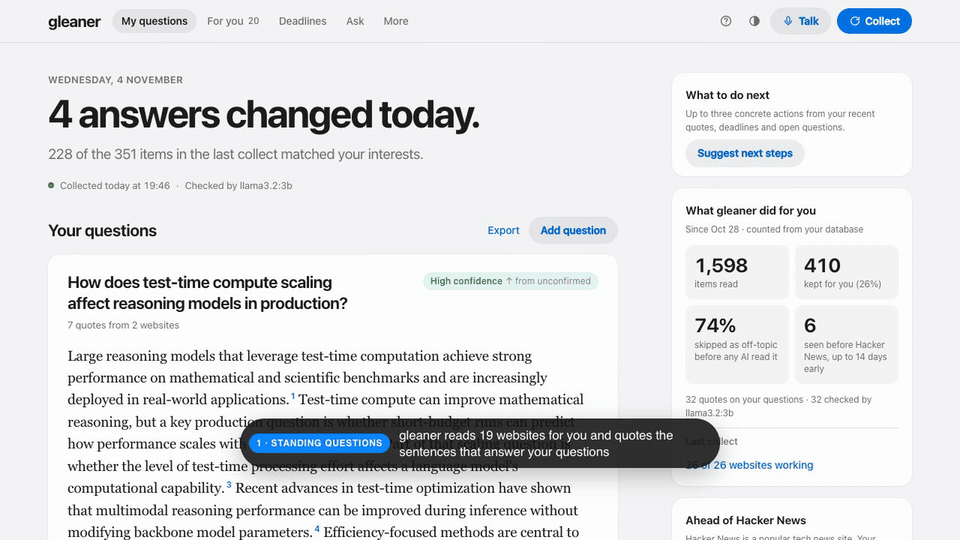

# gleaner

**Keeps the questions you care about answered, and tells you when an answer changes.**



You follow too many sources to read them all. Summaries don't fix that. What you need
to know is what changed, and whether it's true.

gleaner does the reading for you. Every time it collects, it:

1. **Reads** the sources you follow: arXiv, Hacker News, GitHub releases and
   engineering blogs.
2. **Filters** out the noise with Meta's models, and checks that each quote really
   answers your question.
3. **Briefs** you on each question you're working on: what your sources said today,
   quoted word for word and linked.
4. **Suggests** what to do next: Muse Spark turns the brief into a few concrete next
   steps, such as a deadline to act on or a question that still has no evidence.

> One real collect: **1,305 items in, 17 confirmed quotes out.** You read the brief,
> not the firehose.

## Meta's models in gleaner

Each job goes to the smallest Meta model that does it well.

| Model | Where it runs | What it does for the user |
| --- | --- | --- |
| Llama 3.2 3B | On the laptop (Ollama) | Judges every item against your interests, confirms each quote really answers a question, and writes the one-line "what's new" |
| Muse Spark 1.3 | Meta Model API | Writes each cited answer and labels each quote as supporting or contradicting it. Answers Ask, with Llama as the fallback |
| Muse Spark 1.3 with web search | Meta Model API (Responses API, `web_search` tool) | "Find websites": for a question with no quotes yet, finds feeds that write about it. gleaner opens each feed and offers only the ones that work |
| Muse Voice Transcribe 1.0 | Meta Model API (`/v1/asr/transcribe`) | Voice control: press Talk and say "open deadlines", "collect", "read the top 5", or ask anything. The reply is read aloud |
| Llama Prompt Guard 2 (86M) | On the laptop (optional) | Screens fetched text for prompt injection before any model reads it |

**Standing questions** are the
home screen. Every collect updates them: code proposes the passages that match each
question, Llama confirms each match with a yes/no, and Llama sums up what's new in one
line. With `MODEL_API_KEY` set, Muse Spark writes each answer and labels each quote's
stance, and the card shows its confidence and which way it moved since the last answer.
Without it, the home screen shows the checked quotes and says so.

Built for the **Meta Global AI Developer Hackathon** (Cerebral Valley), Indie Developer
track, problem statement **Build for Your World**: building period Oct 27 to Nov 4, 2026.
Everything listed under "Built during the hackathon" was written in that period.

## Built during the hackathon

Everything in this repository except the items under "Pre-existing" was written during
the event.

The first version of the app (`examples/09_discovery/` and `tests/test_discovery_*.py`)
was built on 2026-10-27 in the working tree of my shiori repo, never committed
there, and moved here unchanged on 2026-10-28. This repository's git history starts with one
commit on 2026-11-03, so those dates come from file timestamps, not from git.
On 2026-10-29 it was reorganized into the `gleaner/` package (config in `config/`). The
paths below are under `gleaner/`.

| Feature | Where | Status |
| --- | --- | --- |
| Source connectors: RSS/Atom, arXiv, Hacker News, GitHub (polite fetching, retries, back-off) | `sources/` | done. Tested offline, and live on 2026-10-30 (14 sources, 1,305 items, 0 failures) |
| Normalization, URL canonicalization, exact + MinHash deduplication, story clustering | `normalize.py`, `dedupe.py`, `stories.py` | done |
| Interest profile drafted by an agent, saved only after the user approves | `profile.py`, `workflows.py` | done |
| Noise filter cascade: rules → embedding gate → injection screen → Llama judge (one yes/no question per interest, cached, degrades gracefully) | `filters.py`, `judge.py`, `security.py` | done. The screen is injection patterns, plus Meta's Llama Prompt Guard 2 (86M) when enabled (`GLEANER_PROMPT_GUARD=1`, the `guard` extra). Prompt Guard is tested offline, not yet on the real weights |
| Explainable scoring, one card per story, MMR diversity, source caps | `scoring.py`, `feed.py` | done |
| Digest with citation checking (unsupported bullets dropped) | `digest.py` | done |
| Learning from feedback (Rocchio interest updates, source quality) | `learn.py` | done |
| Trend bursts across independent sources, and opportunities with deadline reminders | `trends.py`, `opportunities.py` | done |
| Ask your feed, with approval before any write tool | `ask.py` | done (not the focus of the demo) |
| Local web API, SSRF guard, offline evaluation (precision@20, nDCG@20, filter recall) | `server.py`, `security.py`, `eval.py` | done |
| Meta models only: Llama 3.2 (local, Ollama) and Muse Spark (Meta Model API, `MODEL_API_KEY`). Muse Glimmer and Prompt Guard names are accepted, any other model is rejected | `llama.py` | done. Tested offline with `MockModel`. Llama 3.2 1B and 3B probed live on real items on 2026-10-30 (see "Model Configuration") |
| Stack watch: OSV advisories for the installed versions of the watched `pyproject.toml`, daily, as the "What changed in my stack?" question | `stack_watch.py`, `questions.py` | done. Tested offline |
| Ahead of Hacker News: kept items checked against HN by URL. The home screen lists those your sources published first | `hn_lead.py`, `dashboard.py` | done. On 2026-10-30, 6 of 80 kept items had reached HN, 8 minutes to 15 days after their source |
| Language: plainly English text is recognized in code, anything else is one short question to the Llama judge. "Exploring" picks just outside your interests (~10% of slots) | `judge.py`, `workflows.py`, `feed.py` | done |
| Embeddings: offline fake embedder (default) and an Ollama embedder (`nomic-embed-text`) with re-indexing on model change | `embed.py`, `db.py` | done. The Ollama embedder isn't wired into the app yet |
| Multi-perspective story cards, funnel telemetry, tunable ranking modes, .ics export | `stories.py`, `feed.py`, `scoring.py`, `opportunities.py`, `dashboard.py` | done |
| Literate programs: ten core pipeline and intelligence modules explained and tangled from `docs/literate/*.md` | `scripts/tangle.py`, `docs/literate/`, `tests/test_literate.py` | done |
| Autonomous cadence scheduler & streaming collect events (SSE): background cadence loop in FastAPI lifespan, real-time progress broadcast | `server.py`, `workflows.py` | done |
| Living answers with Meta Muse Spark: OpenAI-compatible routing to `muse-spark-1.3` on Meta Model API (`https://api.meta.ai/v1`) with citation verification, `synthesized_by` persistence in SQLite, on-demand synthesis endpoint (`POST /api/questions/{id}/synthesize`), and CLI badges | `llama.py`, `questions.py`, `server.py`, `cli.py` | done |
| Research dossier & Obsidian/PKM export: 1-click portable Markdown intelligence report (`/api/export/dossier`, `gleaner questions --export`) with living answers, verbatim quotes, cryptographic receipts (`receipt: #...`), and early HN leads | `dossier.py`, `server.py`, `cli.py`, `dashboard.py` | done |
| Read-only Model Context Protocol (MCP) server: zero-dependency stdio server (`gleaner mcp`) exposing standing answers, evidence search, feed, and dossiers to external coding agents | `mcp.py`, `cli.py`, `tests/test_mcp.py` | done |
| Nostr relay ingestion: decentralized technical research notes and NIP-23 long-form content over HTTP relay gateways, or WebSocket relays when the `websockets` package is installed (not a declared dependency) | `sources/nostr.py`, `tests/test_source_nostr.py` | done. Tested offline |
| Voice control: press Talk and speak. Meta's Muse Voice Transcribe (`muse-voice-transcribe-1.0`, Meta Model API `/v1/asr/transcribe`) turns the 16 kHz clip the page records into text, a fixed grammar maps it to an action (open a view, collect, read the Top 5, add a question) or sends it to Ask, and the browser's built-in speech synthesis reads the reply | `voice.py`, `server.py` (`POST /api/voice`), `dashboard.py` | done. Tested offline, and live against Meta on 2026-11-04 (about 1.5 s per command) |
| Ask on Muse Spark: with `MODEL_API_KEY` set, Ask runs on `muse-spark-1.3` and falls back to Llama, then to a plain search. The answer names the model that wrote it | `llama.py` (`ask_model_names`), `server.py`, `dashboard.py` | done. Tested offline, and live on 2026-11-04 (about 14 s per answer) |
| Find websites for a question: Muse Spark searches the web for RSS or Atom feeds, gleaner fetches each with the collect's own connector and rules, and offers only working feeds with a one-click Add | `discover.py`, `server.py` (`POST /api/questions/{id}/find-feeds`), `dashboard.py` | done. Tested offline, and live on 2026-11-04 (5 working feeds in about 40 s) |
| What to do next: up to 3 concrete next actions grounded in recent quotes, upcoming deadlines, and unanswered questions (Muse Spark with strict ID grounding, or deterministic rules fallback) | `next_steps.py`, `server.py` (`POST /api/next-steps`), `dashboard.py`, `voice.py` | done. Tested offline, and live on 2026-11-04 (3 grounded steps in about 7 s) |
| Repo skeleton, CLI entry point, smoke tests | `__main__.py`, `cli.py`, `tests/test_smoke.py` | done |

## Pre-existing (not hackathon work)

| Component | What it is | Source |
| --- | --- | --- |
| graphflow | My own declarative framework on LangGraph, committed 2026-10-22 (`b8ccb5c`). Pinned to `f43b73e` (2026-10-31), which adds only `graphflow.text`, the chunker below, moved into the package unchanged | [Practicinginhell/shiori@f43b73e](https://github.com/Practicinginhell/shiori/tree/f43b73ecbdc14620e36073d9cda82725169068ec) |
| Tooling | `scripts/` command wrappers, `.github/workflows/ci.yml`, `.editorconfig`, adapted from my shiori repo | same |
| Semantic chunking regex | Structure-preserving Markdown chunker: my Python port of Jina AI's Semantic Chunking Regex v1 (written 2026-08-25), imported from graphflow as `graphflow.text.chunk_text`. gleaner's own part, picking quotable sentences from its chunks, is `gleaner/chunking.py` | [graphflow/text/chunking.py](https://github.com/Practicinginhell/shiori/blob/f43b73ecbdc14620e36073d9cda82725169068ec/graphflow/text/chunking.py) / [tokenize.jina.ai](https://tokenize.jina.ai) |
| OSV API | Open Source Vulnerabilities database API for stack dependency watch (free, official) | [api.osv.dev](https://api.osv.dev) |
| HN Search API | Algolia's official Hacker News search, used to find when an item was posted to HN | [hn.algolia.com/api](https://hn.algolia.com/api) |
| Ollama | Local model runtime that serves Llama on this machine | [ollama.com](https://ollama.com) |
| Meta Model API | Meta's hosted models (Muse Spark, Muse Voice Transcribe), OpenAI-compatible, optional, per role | [developer.meta.com](https://developer.meta.com/ai/resources/blog/build-with-muse-spark/) |
| Third-party libraries | Via graphflow: LangGraph, LangChain Core, Pydantic, regex. The `llama` extra: langchain-openai, openai. The optional `guard` extra: transformers, torch. Runtime dependencies in `pyproject.toml`: feedparser, trafilatura, datasketch, scikit-learn, sqlite-vec, FastAPI, uvicorn, Jinja2, httpx, PyYAML. Development: pytest, pytest-asyncio, ruff | PyPI, under their own licenses |

## Run

Requires Python 3.15 (it uses 3.15 features).

```bash
conda create -n gleaner python=3.15 && conda activate gleaner
./scripts/setup                              # pip install -e ".[dev,llama]" (pulls the pinned graphflow)
ollama pull llama3.2:3b                      # the judge and the writer
./scripts/test                               # offline test suite
./scripts/dev demo                           # offline end-to-end demo

./scripts/dev init        # load config/sources.yaml + config/interests.yaml (asks before saving; --yes skips)
./scripts/dev collect     # one collection tick: live sources + the Llama judge (--offline uses fixtures)
./scripts/dev feed        # print the ranked feed
./scripts/dev serve       # local web UI and API at http://127.0.0.1:8000
```

Muse Spark and voice need a Meta Model API key in the environment. gleaner doesn't read
`.env` files itself, so export it in the shell that starts the server:

```bash
export MODEL_API_KEY=...   # optional: answers, Ask, Find websites and voice on the Meta Model API
ollama serve               # Llama for the judge and the writer
```

The database lives in `data/gleaner.db` (gitignored).

## How it works

- **Local-first, single user**: everything is in one SQLite file (FTS5 and `sqlite-vec`).
  Besides your sources, the optional Meta Model API and the OSV and HN Search lookups, the only
  service is the local Ollama endpoint for the Llama models.
- **Content rules**: `config/interests.yaml` excludes medical, political and war-related
  items in Stage A (the hackathon bans that content), as whole words or phrases.
- **Cheap filters first**: rules, then an embedding gate, then the injection screen (patterns, plus
  Prompt Guard when enabled), and only the
  survivors reach the Llama judge. The dashboard reports how many items each stage drops.
- **Explainable ranking**: every card shows its weighted score breakdown and why it
  matches your interests.
- **graphflow workflows**: declarative collection, per-source failure isolation with
  back-off, and human approval before any write action.

### Model Configuration (Ollama / Local Models)

gleaner uses Meta's models only. `llama3.2:3b` judges and writes (the one-line "what
changed" and the digest), and answers Ask when no key is set. With `MODEL_API_KEY` set,
Muse Spark (`muse-spark-1.3`, on the Meta Model API at `https://api.meta.ai/v1`) writes the
answers, answers Ask and searches the web for feeds, and Muse Voice Transcribe hears voice
commands. Pick another Meta model per role through an environment variable or the
`--model` flag. Any other model name is rejected. Muse Spark was tested live on 2026-11-01
but not measured the way the table below measures Llama.

Small Llamas write well and judge poorly. Measured on 2026-10-30 against real collected items:

| Task | Llama 3.2 1B | Llama 3.2 3B |
| --- | --- | --- |
| Sum up quotes code matched, in one sentence | faithful | faithful |
| "Does this sentence help answer this question?" (21 real matches, then the same sentences under the wrong question) | yes 21/21, wrong question 21/21 | yes 17/21, wrong question 1/21 |
| Item judge: relevance to the interest profile | off-topic papers 0.8 to 0.9 like on-topic | same, plus 9 of 12 typed "opportunity" and 3 of 12 invalid JSON |
| Free-form claim extraction | 4 of 6 replies invalid JSON, with invented links | restates the question as a "claim" under unrelated papers |
| Item judge as one yes/no per interest (what gleaner uses) | not run | a full real collect: 262 kept items, 803 calls, 8 minutes, then cached. The 138 judged about none were off-topic in every one checked (cloud outages, IPO news, retro Macs). Its "yes" is generous (most agent papers count as Agent Frameworks, "test-time compute" over-tagged) |
| Evidence check: a keyword-matched sentence confirmed yes/no (what gleaner uses) | not run | same collect: kept 16 test-time-compute quotes, turned down "These findings…"-style generic sentences and both LangGraph "failure modes" matches (they were about other systems). With the sentence fenced as untrusted data it confirmed 1 of 21 real matches, so that prompt is unfenced: its reply only becomes a yes/no |

So gleaner asks Llama only yes/no questions (is this item about an interest, does this
sentence help answer a question) and to word a one-line summary. Code does the rest.
On this machine a 3B call takes 0.4 to 2 s, so a first collect with ~260 kept items takes
several minutes. Later collects judge only new items (cached).

Setting `GLEANER_MODEL` sets every role, the judge included.

Voice replies are spoken by the browser's built-in speech synthesis (the operating system's
voice), since Meta has no text-to-speech model. Speech-to-text is Meta's Muse Voice Transcribe.

```bash
# Per role (judge, writer, answer, ask):
export LLAMA_JUDGE_MODEL="llama3.1:8b"
export LLAMA_WRITER_MODEL="muse-spark-1.3"   # Meta Model API; needs MODEL_API_KEY
./scripts/dev ask "What are the latest updates on Graphflow?"

# Or for one command:
./scripts/dev ask --model "llama3.2:3b" "What is Graphflow?"
./scripts/dev digest --model "llama3.2:3b"
```

### Prompt Guard 2 (optional)

Fetched text is screened for prompt injection before any model reads it. By default the
screen is a list of injection patterns. To add Meta's Llama Prompt Guard 2 classifier (86M):
accept Meta's license for `meta-llama/Llama-Prompt-Guard-2-86M` on Hugging Face, log in with
`hf auth login`, then:

```bash
pip install -e ".[guard]"         # transformers + torch
export GLEANER_PROMPT_GUARD=1
```

Blocked items say which screen blocked them ("Matched pattern: …" or "Llama Prompt Guard 2: …").
