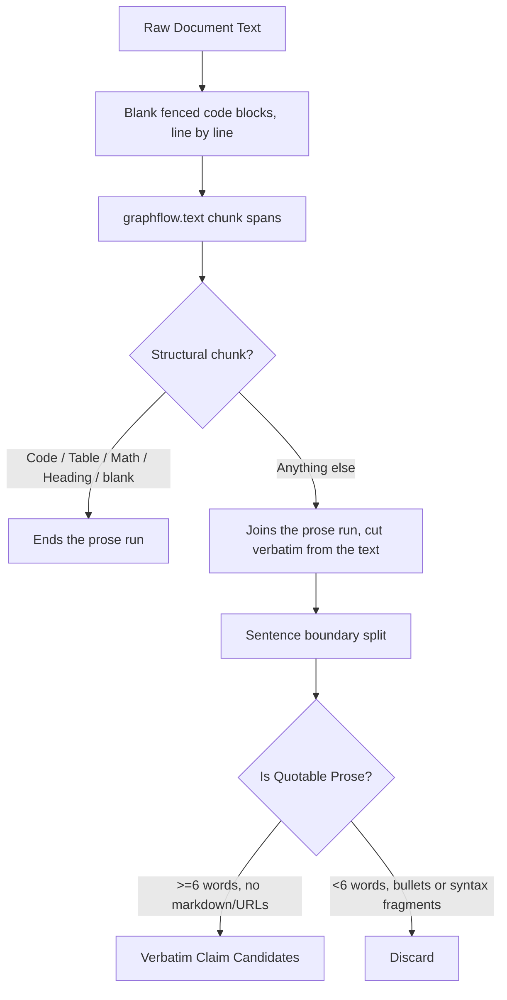

# Chunking: Quotable Prose from Structured Text

In technical intelligence retrieval, naive sentence segmentation (such as splitting on `. `, `! `, or `? `)
is catastrophically destructive. Scientific papers, developer blogs, and release notes are dense with
source code, LaTeX mathematical expressions, markdown tables, decimal versions (e.g. `Python 3.15.1`),
and URLs. A naive splitter fragments code blocks into gibberish and extracts syntax fragments as false "claims".

The segmentation itself is not gleaner's: `graphflow.text.chunk_text` is the author's pre-existing
port of Jina AI's Semantic Chunking Regex v1 (written 2026-08-25, part of graphflow since commit
`f43b73e`; see the README's "Pre-existing" table). It recognizes 14 constructs in priority order
(headings, lists, block quotes, code blocks, tables, rules, sentences, quoted spans, paragraphs,
lines, HTML, math, emoji, and a fallback) so that tables, math and code stay whole.

`gleaner.chunking` is the part built for gleaner: it turns those chunks into **verbatim, quotable
prose sentences** for standing-question evidence, and covers two limits of the chunker that matter
for quotes:

- Its fenced-code rule spans at most 1000 characters. A longer block isn't matched as code, and its
  lines come back as "sentences". gleaner finds fences itself, line by line, and blanks them first.
- Its sentence rule spans at most 300 characters; longer runs fall to the 200-character fallback,
  cut mid-word. gleaner uses the chunks only to locate the structural blocks, and splits sentences
  itself from the original text between them.



---

## File Structure

The module `gleaner/chunking.py` tangles from the following structure:

```python
<<gleaner/chunking.py>>=
<<chunking module docstring>>

<<chunking imports>>


<<fenced code detection>>


<<structural block detection>>


<<prose sentence validator>>


<<extract prose sentences function>>
```

```python
<<chunking module docstring>>=
"""Quotable prose sentences from structured text, for standing-question evidence.

Segmentation is graphflow's (``graphflow.text``, the author's pre-existing port of Jina AI's
Semantic Chunking Regex v1); this module only decides which text is quotable prose.
"""
```

```python
<<chunking imports>>=
from __future__ import annotations

import re

from graphflow.text.chunking import CHUNK_RE
```

`CHUNK_RE` is the compiled pattern behind `graphflow.text.chunk_text`. Its match spans tell us where
each chunk sits in the text, so a run of prose can be cut from the original text exactly.

---

## Fenced Code, Found by Line

A fence opens on a line starting (after up to three spaces) with ```` ``` ```` or `~~~`, and closes
on the next line starting with the same marker. An unclosed fence runs to the end of the text, as
Markdown renders it. Each fenced region is replaced by spaces, keeping newlines, so every offset
still points into the original text:

```python
<<fenced code detection>>=
def _blank_fenced_code(text: str) -> str:
    """Blank out fenced code blocks, whatever their length.

    Args:
        text: The document text.

    Returns:
        ``text`` with every character of a fenced code block (fence lines included) turned to a
        space, newlines kept, so offsets still line up with the original.
    """
    out: list[str] = []
    marker: str | None = None  # the open fence's ``` or ~~~
    for line in text.splitlines(keepends=True):
        stripped = line.lstrip(" ")
        fence = stripped[:3] if len(line) - len(stripped) <= 3 and stripped[:3] in ("```", "~~~") else None
        if marker is None and fence is None:
            out.append(line)
            continue
        out.append(re.sub(r"[^\r\n]", " ", line))
        if marker is None:
            marker = fence
        elif fence == marker:
            marker = None
    return "".join(out)
```

---

## Structural Filtering & Prose Extraction

Before extracting evidence claims for standing questions, we must filter out non-prose structures.
`_is_structural_block` detects non-prose constructs that should never be fragmented into candidate
claims. A blanked code region is whitespace, so it counts as structural too:

```python
<<structural block detection>>=
def _is_structural_block(chunk: str) -> bool:
    """Return True if a chunk is blank, code, a table, math, a heading or a rule."""
    s = chunk.strip()
    if not s:
        return True
    # Fenced code blocks or pre tags
    if s.startswith(("```", "~~~", "<pre")):
        return True
    # Tables
    if (s.startswith("|") and "|" in s[1:]) or s.startswith("<table"):
        return True
    # LaTeX display math
    if s.startswith("$$"):
        return True
    # Headings and rules
    if s.startswith(("#", "<h1", "<h2", "<h3", "<h4", "<h5", "<h6", "---", "***", "<hr")):
        return True
    return False
```

### The Prose Sentence Gate

A valid evidence quote must be authentic prose: at least six words long, without markdown links,
raw URLs, backticks, or a leading list or quote marker (so bulleted release notes give no quotes):

```python
<<prose sentence validator>>=
def _is_prose_sentence(sentence: str) -> bool:
    """Return True for quotable prose: six words or more, no markdown or code fences."""
    words = sentence.split()
    if len(words) < 6:
        return False
    # Avoid markdown links, code blocks, raw URLs, or table delimiters
    return not bool(re.search(r"\]\(|https?://|```|`|^[#*>|\[-]", sentence))
```

### End-to-End Extraction

`extract_prose_sentences` blanks fenced code, walks the chunk spans, and collects each run of
consecutive non-structural chunks as one verbatim stretch of the original text. Spans are trimmed
to their visible text, and a run ends wherever blanked code lies between two chunks: the chunker's
sentence rule ends in `\s+`, which would otherwise swallow a whole blanked block. Sentences are then
split on terminal punctuation followed by whitespace (so `3.15.1` stays whole; an abbreviation such
as `Dr. Smith` does split) and on newlines:

```python
<<extract prose sentences function>>=
def extract_prose_sentences(text: str) -> list[str]:
    """Extract clean, quotable prose sentences from a document.

    Uses semantic chunking first to filter out code blocks, tables, math, and
    headings, preventing non-prose lines from being butchered into fake claims.

    Args:
        text: The document text.

    Returns:
        The prose sentences in document order; each is an exact substring of ``text``.
        Empty when ``text`` is empty.
    """
    if not text:
        return []

    blanked = _blank_fenced_code(text)
    runs: list[str] = []
    run_start: int | None = None
    run_end = 0
    for m in CHUNK_RE.finditer(blanked):
        chunk = m.group(0)
        start = m.start() + len(chunk) - len(chunk.lstrip())
        end = m.start() + len(chunk.rstrip())
        structural = _is_structural_block(chunk)
        # a sentence chunk's trailing \s+ can swallow a blanked code block: never join across one
        if run_start is not None and (structural or text[run_end:start] != blanked[run_end:start]):
            runs.append(text[run_start:run_end])
            run_start = None
        if structural:
            continue
        if run_start is None:
            run_start = start
        run_end = end
    if run_start is not None:
        runs.append(text[run_start:run_end])

    sentences: list[str] = []
    for run in runs:
        sub_sentences = [s.strip() for s in re.split(r"(?<=[.!?])\s+|\n+", run)]
        sentences.extend(s for s in sub_sentences if s and _is_prose_sentence(s))
    return sentences
```

---

## Callers and Verification

### Callers
- `gleaner.questions.extract_claims_for_item`: keyword candidates for standing questions come only
  from these sentences.

### Verification
- `tests/test_chunking.py`: `test_extract_prose_sentences_isolates_quotable_prose`,
  `test_extract_claims_for_item_ignores_code_blocks_and_extracts_prose_claim`,
  `test_a_code_block_longer_than_the_chunkers_limit_is_still_not_prose`,
  `test_a_long_sentence_is_quoted_whole_not_in_fragments`; the `test_chunk_text_*` tests there pin
  the graphflow chunker behavior gleaner relies on (code blocks, tables and math kept whole).
