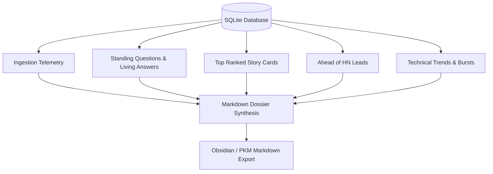

# Research Dossier: Portable PKM-Compatible Intelligence Export

Modern knowledge workers and researchers organize their workflows around **Personal Knowledge
Management (PKM)** systems such as Obsidian, Logseq, and Roam Research. A feed reader that confines
intelligence to a closed web GUI forces manual copy-pasting, losing metadata, provenance, and citation
links in the process.

`gleaner.dossier` solves this by synthesizing the proactive intelligence state into a **portable,
self-contained Markdown dossier**. The generated dossier is formatted with standard GitHub-Flavored
Markdown (GFM) that Obsidian and other PKM tools open as is, preserving:

- **Ingestion & compute efficiency telemetry**: transparent accounting of filtering cascades and compute savings.
- **Standing questions & living answers**: current answer text, versioning, confidence level, model attribution, and delta explanation ("What Changed").
- **Grounded verbatim evidence quotes**: hyperlinked source citations with primary origin keys.
- **Strongest counterpoint claims**: surfacing conflicting evidence to prevent confirmation bias.
- **Track-record accuracy**: transparent verification hit-rates based on user feedback.
- **Triangulated story cards**: multi-perspective analysis (academic theory, engineering implementation, and community sentiment).
- **Early insights ("Ahead of Hacker News")**: items surfaced days before appearing on social aggregators.
- **Active technical trends & bursts**: velocity and burst scoring of emerging technical concepts.



---

## File Structure

The module `gleaner/dossier.py` tangles from the following chunk layout:

```python
<<gleaner/dossier.py>>=
<<dossier docstring>>

<<dossier imports>>


<<dossier markdown link helper>>


<<generate dossier function>>
```

```python
<<dossier docstring>>=
"""Comprehensive Research Dossier Generation (ADR-0007, M17).

Export full proactive intelligence state into portable, Obsidian/PKM-compatible Markdown:
- Standing questions and living cited answers with version and confidence
- Delta ("What Changed") and verbatim quoted evidence with hyperlinks
- Strongest counterpoints and track-record accuracy
- Triangulated story cards (theory, practice, community pulse)
- Early insights ("Ahead of Hacker News" leads)
- Detected technical trends and bursts
"""
```

```python
<<dossier imports>>=
from __future__ import annotations

from datetime import UTC, datetime
from urllib.parse import quote

from gleaner.db import Database
from gleaner.feed import generate_feed
from gleaner.hn_lead import hn_leads
from gleaner.questions import compute_claim_receipt
from gleaner.trends import detect_trends
```

---

## Feed Text in Markdown Links

Titles and URLs come from feeds, so they are untrusted. A title containing `](http://…)` would
close the link early and point it elsewhere, and a URL with a space or `)` would break it. Brackets
in the title are escaped, the URL is percent-encoded, and only http(s) links are linked at all.

```python
<<dossier markdown link helper>>=
def _md_link(title: str, url: str | None) -> str:
    """Return a Markdown link a feed's title or URL can't break out of.

    Non-http(s) URLs give the escaped title as plain text.
    """
    text = title.replace("\\", "\\\\").replace("[", "\\[").replace("]", "\\]")
    if not url or not url.lower().startswith(("http://", "https://")):
        return text
    return f"[{text}]({quote(url, safe=":/?#&=%@+,;~*!$'")})"
```

---

## Dossier Assembly Engine

The `generate_dossier` entry point coordinates reading from the database and formatting each section in priority order.

```python
<<generate dossier function>>=
def generate_dossier(db: Database, today: datetime | None = None) -> str:
    """Generate a self-contained Markdown research dossier for PKM export.

    Args:
        db: The gleaner database to report from.
        today: The dossier's date; defaults to the current UTC time.

    Returns:
        The dossier as Markdown, ending with a single newline.
    """
    now = today or datetime.now(UTC)
    date_str = now.strftime("%Y-%m-%d")

    lines: list[str] = [
        f"# Gleaner Intelligence Dossier for {date_str}",
        "",
        "> Personal proactive intelligence report with code-verified verbatim citations.",
        "> Generated by **gleaner** from its local database.",
        "",
    ]

    <<dossier telemetry section>>

    <<dossier standing questions section>>

    <<dossier stories section>>

    <<dossier hn leads section>>

    <<dossier trends section>>

    return "\n".join(lines).strip() + "\n"
```

---

## Telemetry & Compute Efficiency

We record transparent metrics on the multi-stage cascade. By measuring the ratio of raw fetched items to items evaluated by LLMs, the dossier proves local compute efficiency.

```python
<<dossier telemetry section>>=
# 1. Telemetry & Compute Efficiency Summary
telem = db.get_telemetry("latest")
if telem and telem.get("fetched"):
    fetched = telem.get("fetched", 0)
    scored = telem.get("scored", 0)
    judged = telem.get("judged_llama", 0)
    saved = telem.get("compute_saved_pct")
    saved_str = f"{saved:.1f}%" if saved is not None else "N/A"
    lines.extend([
        "## Ingestion & Compute Efficiency",
        f"- **Items Fetched Across Sources**: {fetched:,}",
        f"- **On-Topic Items Kept**: {scored:,}",
        f"- **Evaluated by Meta Llama**: {judged:,}",
        f"- **Compute Saved by Cascade**: {saved_str} (filtered by cheap heuristic rules and semantic embedding gate)",
        "",
    ])
```

---

## Standing Questions & Grounded Answers

Standing questions represent persistent inquiries tracked across time (ADR-0007). Each question card in the dossier provides:
- The synthesized living answer block.
- A confidence level from independent origins (`compute_confidence`), shown only when a model took a
  stance on the quotes or wrote the answer. Quotes alone have stance "context", so their confidence
  would always read INSUFFICIENT; the dashboard hides it for the same reason.
- Verbatim quoted evidence with hyperlinked citations to source documents.
- Cryptographic claim receipts (`receipt: #<hash>`): deterministic 16-character SHA-256 hashes binding origin key, verbatim quote, and item ID for tamper-evident provenance across PKM tools.
- Strongest counterpoint claims to highlight trade-offs or conflicting benchmarks.
- Verified track-record hit-rate percentage.

```python
<<dossier standing questions section>>=
# 2. Standing Questions & Living Answers
lines.extend([
    "## Standing Questions & Living Answers",
    "",
])

questions = db.list_questions()
if not questions:
    lines.extend([
        "_No standing questions tracked yet. Add them to `config/questions.yaml`._",
        "",
    ])
else:
    for q in questions:
        latest = db.get_latest_answer(q.id)
        claims = db.list_claims_for_question(q.id)
        hit_rate = db.get_track_record_hit_rate(q.id)

        lines.append(f"### {q.text}")
        if q.linked_interests:
            lines.append(f"_Interests: {', '.join(q.linked_interests)}_")
        if q.watch:
            lines.append(f"_Watching: `{q.watch}`_")

        if latest:
            synth = latest.synthesized_by or "verbatim quotes"
            judged = latest.synthesized_by is not None or any(c.stance != "context" for c in claims)
            conf = f" • **Confidence**: {latest.confidence.upper()}" if judged else ""
            lines.append(f"- **Version**: {latest.version}{conf} • **Synthesized by**: {synth}")
            if latest.what_changed:
                by = f" (by {latest.what_changed_by})" if latest.what_changed_by else ""
                lines.append(f"- **What Changed**: {latest.what_changed}{by}")

            lines.append("")
            # Living answer sentences
            if latest.sentences:
                answer_text = " ".join(s.text for s in latest.sentences)
                lines.extend([
                    "**Living Answer:**",
                    f"> {answer_text}",
                    "",
                ])

            # Counterpoint
            if latest.counterpoint_claim_id:
                cp = db.get_claim(latest.counterpoint_claim_id)
                if cp:
                    lines.extend([
                        f"- **Strongest Counterpoint**: {cp.text} (`{cp.origin_key}`)",
                        "",
                    ])

            # Grounded verbatim evidence quotes
            if claims:
                lines.append("#### Grounded Evidence Citations:")
                for idx, c in enumerate(claims, 1):
                    item = db.get_item(c.item_id) if c.item_id else None
                    src_title = item.title if item else c.origin_key
                    src_url = item.url if item and item.url else ""
                    link_md = _md_link(src_title, src_url)
                    receipt = compute_claim_receipt(c)
                    lines.append(f"{idx}. > \"{c.quote}\"\n   Source: {link_md} (`{c.origin_key}`) • `receipt: #{receipt}`")
                lines.append("")
        else:
            lines.extend([
                "_Insufficient evidence gathered yet to synthesize a verified answer._",
                "",
            ])

        if hit_rate.get("total", 0) > 0:
            # the rate is over answers judged useful or wrong; "already knew" isn't counted
            judged_count = hit_rate.get("useful", 0) + hit_rate.get("wrong", 0)
            lines.append(f"_Track Record: {hit_rate.get('hit_rate_pct', 0.0):.1f}% useful ({hit_rate.get('useful')}/{judged_count})_")
        lines.append("---")
        lines.append("")
```

---

## Triangulated Intelligence Stories

Story cards triangulate multiple sources into unified narratives, highlighting relevance, novelty, and multi-perspective breakdowns across research, implementation, and community reaction.

```python
<<dossier stories section>>=
# 3. Triangulated Stories
cards = generate_feed(db, limit=8, mode="balanced")
if cards:
    lines.extend([
        "## Top Ranked Intelligence & Story Cards",
        "",
    ])
    for idx, c in enumerate(cards, 1):
        p = c.components
        item_url = c.item.url or ""
        title_md = _md_link(c.item.title, item_url)
        lines.append(f"### {idx}. {title_md}")
        lines.append(f"- **Source**: `{c.item.source_id or 'unknown'}` • **Score**: {c.score:.3f} (rel={p.relevance:.2f}, nov={p.novelty:.2f}, qual={p.quality:.2f})")
        if c.why:
            lines.append(f"- **Why It Matters**: {c.why}")
        if c.summary and c.summary != c.item.title:
            lines.append(f"- **Summary**: {c.summary}")
        if c.perspectives:
            lines.append("- **Multi-Perspective Breakdown**:")
            for k, v in c.perspectives.items():
                lines.append(f"  - **{k.replace('_', ' ').title()}**: {v}")
        if c.also_covered_by:
            lines.append(f"- **Also Covered By**: {', '.join(c.also_covered_by)}")
        lines.append("")
```

---

## Ahead of Hacker News Leads

Tracks early-stage discoveries detected on developer blogs, release feeds, or pre-print archives hours or days before reaching social aggregators like Hacker News.

```python
<<dossier hn leads section>>=
# 4. Ahead of Hacker News Leads
leads = hn_leads(db)
if leads:
    lines.extend([
        "## Early Insights: Ahead of Hacker News",
        "> Items discovered on your followed sources days before appearing on the Hacker News frontpage.",
        "",
    ])
    for lead in leads[:5]:
        item_url = lead.item.url or ""
        lead_md = _md_link(lead.item.title, item_url)
        days = lead.lead.total_seconds() / 86400.0
        lead_time = f"{days:.1f} days" if days >= 1.0 else f"{lead.lead.total_seconds() / 3600.0:.1f} hours"
        lines.append(f"- ⚡ **{lead_md}** (Spotted `{lead_time}` ahead of HN submission · [HN Discussion]({lead.hn_url}))")
    lines.append("")
```

---

## Emerging Technical Trends

Summarizes detected topic bursts, displaying keyword velocity, burst multiplier scores, and cluster sizes.

```python
<<dossier trends section>>=
# 5. Active Trends
trends = detect_trends(db)
if trends:
    lines.extend([
        "## Active Technical Trends & Bursts",
        "",
    ])
    lines.extend(f"- **{t.label}** (z-score {t.z_score:.1f}, {len(t.story_ids)} stories)" for t in trends[:5])
    lines.append("")
```

---

## Verification

The behavior of `gleaner.dossier` is verified by the offline pytest suite in `tests/test_dossier.py`:

- Empty database graceful fallback: `test_generate_dossier_empty_db`.
- Comprehensive dossier with questions, living answers, grounded quotes, and story cards: `test_generate_dossier_with_questions_and_stories`.
- Server HTTP API endpoint and content disposition attachment headers: `test_api_export_dossier_endpoint`.
- Multi-source technical trends and burst clusters: `test_dossier_lists_detected_trends`.
- Feed link bracket escaping and tamper-evident claim receipt badges: `test_dossier_shows_no_confidence_for_unjudged_quotes_and_escapes_feed_links`.

---

## Maintenance Notes

- **Link Escaping**: Markdown links must remain safe against injection. Feed titles containing brackets `[` or `]` are escaped, and URLs are percent-encoded via `quote(..., safe=":/?#&=%@+,;~*!$'")`.
- **Claim Receipts**: The SHA-256 receipt binds `origin_key:quote:item_id` so that notes imported into Obsidian retain verifiable provenance.
- **Header Safety**: The HTTP export endpoint sets attachment headers based on the current date; filenames must never allow CRLF injection.

---

## Chunk Index

- `<<gleaner/dossier.py>>`: Root tangle destination.
- `<<dossier docstring>>`: Module documentation and architectural summary.
- `<<dossier imports>>`: Standard library and internal gleaner imports.
- `<<dossier markdown link helper>>`: `_md_link` URL percent-encoding and bracket escaping.
- `<<generate dossier function>>`: Primary `generate_dossier` orchestrator.
- `<<dossier header section>>`: Ingestion efficiency telemetry and compute cascade counters.
- `<<dossier standing questions section>>`: Questions, living answers, quotes, and receipts.
- `<<dossier story cards section>>`: Triangulated multi-perspective story cards.
- `<<dossier hn leads section>>`: Early technical insights ahead of Hacker News.
- `<<dossier trends section>>`: Emerging topic velocity and cluster bursts.
