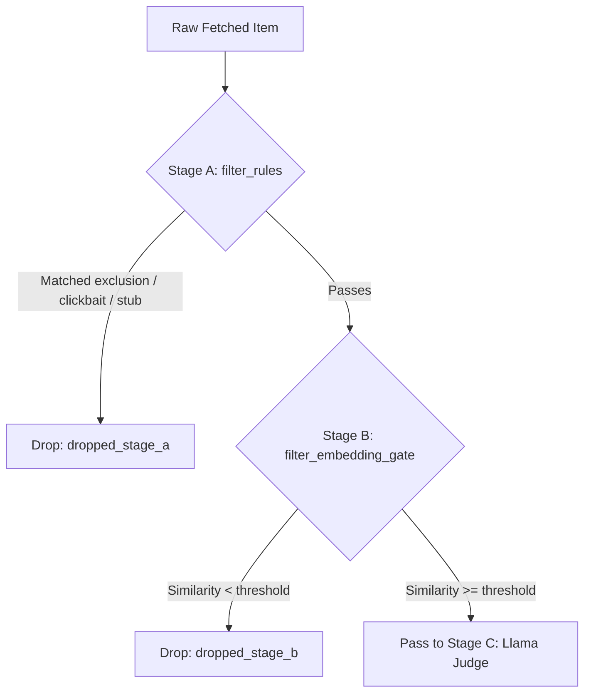

# Filters: The Early-Triage Cascade

In gleaner's discovery feed, raw documents arrive continuously from RSS feeds, arXiv papers,
GitHub repositories, and Hacker News posts. Evaluating all incoming documents with an LLM judge
would be prohibitive in both latency and compute cost ($O(N)$ inference on hundreds of daily items).

To safeguard system resources and maintain sub-second response times, `gleaner.filters` implements
a **two-stage early-triage cascade**:

1. **Stage A (`filter_rules`)**: Pure $O(1)$ heuristic and regex screening. It filters out
   explicit user exclusions (including hackathon non-negotiable content rules such as medical,
   political, and military topics), blatant clickbait, excessive capitalization, and short stubs.
2. **Stage B (`filter_embedding_gate`)**: Vector similarity against active interest profile centroids.
   Only documents exceeding a minimum semantic threshold proceed to the expensive Stage C Llama judge.



---

## File Structure

The module `gleaner/filters.py` is tangles from the following high-level root:

```python
<<gleaner/filters.py>>=
<<filters module docstring>>

<<filters imports>>

<<clickbait phrases>>


<<filter rules function>>


<<filter embedding gate function>>
```

```python
<<filters module docstring>>=
"""Relevance filtering cascade: Stage A (rules) and Stage B (embedding gate)."""
```

```python
<<filters imports>>=
from __future__ import annotations

import re
from collections.abc import Sequence

from gleaner.embed import cosine_similarity
from gleaner.models import Item
```

---

## Stage A: Rule-Based Filtering

Stage A executes in fractions of a microsecond per item. It examines three distinct signals:
exclusion keywords, sensationalized title heuristics, and minimum document length.

### Clickbait Patterns

We maintain a tuple of common clickbait phrases that signal low-signal sensationalism:

```python
<<clickbait phrases>>=
CLICKBAIT_PHRASES = (
    "you won't believe",
    "you will not believe",
    "one weird trick",
    "shocking truth",
    "secret methods",
    "will blow your mind",
    "what happens next",
    "doctors hate him",
    "make money fast",
)
```

### The `filter_rules` Implementation

```python
<<filter rules function>>=
def filter_rules(
    item: Item,
    exclusions: Sequence[str] = (),
    min_article_length: int = 200,
) -> tuple[bool, str]:
    """Stage A: free rule-based filter checking exclusions, spam/clickbait, and length.

    Args:
        item: The item to check (title and text).
        exclusions: Keywords that drop the item when found as a whole word, case-insensitive.
        min_article_length: Minimum text length, in characters, for article and news items.

    Returns:
        ``(passed, reason)``: whether the item passed, and why it was dropped (or that it passed).
    """
    # 1. Exclusions
    <<check exclusions>>

    # 2. Clickbait heuristics
    <<check clickbait>>

    # 3. Minimum article length
    <<check length>>

    return True, "Passed Stage A rules"
```

#### 1. Exclusion Keywords

A critical design invariant is the use of regex lookarounds `(?<!\w)...(?!\w)` rather than
naive word boundary markers `\b`. Naive boundaries fail when keywords contain non-word characters
such as `"C++"`, `".NET"`, or `"#ad"`.

```python
<<check exclusions>>=
combined_text = f"{item.title} {item.text}".lower()
for exc in exclusions:
    exc_clean = exc.strip().lower()
    # Lookarounds, not \b: \b never matches beside a non-word edge such as "C++", ".NET" or "#ad".
    if exc_clean and re.search(r"(?<!\w)" + re.escape(exc_clean) + r"(?!\w)", combined_text):
        return False, f"Matched exclusion keyword '{exc_clean}'"
```

#### 2. Clickbait and Sensationalism

Clickbait titles frequently employ excessive capitalization (e.g. SHOCKING ANNOUNCEMENT) or
repeated exclamation points (`!!!`, `???`). We reject titles where uppercase letters exceed 65%
of alphabetical characters (for titles of 20 characters or longer), as well as titles containing
our known clickbait phrases.

```python
<<check clickbait>>=
title = item.title.strip()
if len(title) >= 20:
    alpha_chars = [c for c in title if c.isalpha()]
    if alpha_chars and (sum(1 for c in alpha_chars if c.isupper()) / len(alpha_chars)) > 0.65:
        return False, "Clickbait: excessive uppercase characters in title"

if re.search(r"[!?]{3,}", title):
    return False, "Clickbait: excessive punctuation in title"

title_lower = title.lower()
for phrase in CLICKBAIT_PHRASES:
    if phrase in title_lower:
        return False, f"Clickbait phrase detected: '{phrase}'"
```

#### 3. Length Constraints

Stubs and empty news snippets cannot be meaningfully analyzed or cited. For items classified as
`article` or `news`, we require at least `min_article_length` (default 200) characters.

```python
<<check length>>=
if item.kind in ("article", "news") and len(item.text.strip()) < min_article_length:
    return False, f"Article too short ({len(item.text.strip())} < {min_article_length} chars)"
```

---

## Stage B: Embedding Gate

Items that pass Stage A are embedded into semantic dense vectors. Before submitting them to an
LLM, `filter_embedding_gate` computes the cosine similarity against each active user interest:

$$\text{sim}(u, v) = \frac{u \cdot v}{\|u\|_2 \|v\|_2}$$

Each interest $i$ has a centroid vector $c_i$ and a weight $w_i$. The weighted similarity is:

$$\text{sim}_{\text{weighted}} = \text{sim}(u, c_i) \times w_i$$

```python
<<filter embedding gate function>>=
def filter_embedding_gate(
    item: Item,
    item_vec: list[float],
    interests: Sequence[tuple[str, list[float], float]],
    threshold: float = 0.35,
) -> tuple[bool, float, str]:
    """Stage B: cheap semantic embedding gate.

    Args:
        item: The item being gated (not read; the vector stands for it).
        item_vec: The item's embedding.
        interests: Sequence of ``(interest_id, centroid_vector, weight)``.
        threshold: Minimum weighted similarity to pass.

    Returns:
        ``(passed, max_similarity, best_interest_id)``, where the similarity is the cosine times
        the interest's weight. With no interests, ``(True, 1.0, "default")``.
    """
    if not interests:
        return True, 1.0, "default"

    best_sim = -1.0
    best_id = ""

    for int_id, centroid, weight in interests:
        raw_sim = cosine_similarity(item_vec, centroid)
        weighted_sim = raw_sim * weight
        if weighted_sim > best_sim:
            best_sim = weighted_sim
            best_id = int_id

    passed = best_sim >= threshold
    return passed, best_sim, best_id
```

---

## Callers and Verification

### Callers
- `gleaner.workflows.run_collect_tick`: Applies `filter_rules` and `filter_embedding_gate`
  during each collection cycle.
- `gleaner.eval`: measures filter recall (and the feed's precision@20) on a synthetic fixture.

### Verification
- `tests/test_discovery_filters.py`: `test_stage_a_rules_filters_exclusions`,
  `test_stage_a_rules_filters_clickbait`, `test_stage_a_rules_filters_short_articles`,
  `test_stage_a_exclusions_match_terms_with_non_word_edges`,
  `test_stage_a_exclusions_still_respect_word_boundaries`,
  `test_stage_b_embedding_gate_drops_off_topic_with_zero_model_calls`.

---

## Maintenance Notes

- When adding new exclusions via `config/interests.yaml`, ensure no broad substrings are introduced
  without testing boundaries.
- The default gate threshold ($0.35$) has not been calibrated on a real embedding model: the app
  runs the offline `FakeEmbedder` today (the Ollama embedder exists in `embed.py` but isn't wired in).
  Measure it on real vectors before relying on it.

---

## Chunk Index

- `<<gleaner/filters.py>>`
- `<<filters module docstring>>`
- `<<filters imports>>`
- `<<clickbait phrases>>`
- `<<filter rules function>>`
- `<<check exclusions>>`
- `<<check clickbait>>`
- `<<check length>>`
- `<<filter embedding gate function>>`
