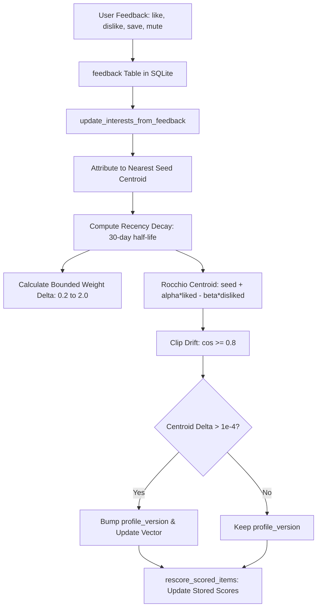

# Learn: Rocchio Feedback Adaptation and Centroid Drift Bounds

A personal discovery feed must adapt to implicit and explicit user feedback. However, naive
reinforcement loops in recommendation engines suffer from well-known pathological failure modes:

1. **Weight Explosion**: Every like or save monotonically increases weights without a normalizing
   reference point, quickly pegging scores at arbitrary maxima.
2. **Topic Drift (Centroid Wandering)**: If interest centroids move unconstrained toward user clicks,
   a single viral clickbait article or off-topic paper can pull an interest in "Distributed Systems"
   into general cryptocurrency or gaming news.
3. **Invalidating Caches**: Incrementing profile versions on every micro-interaction wipes out
   expensive LLM judgment caches in SQLite.

`gleaner.learn` implements a **bounded, closed-form Rocchio adaptation loop** (Rocchio, 1971):

- **Attribution**: Feedback items are attributed to the single nearest interest seed centroid.
- **Recency Decay**: Interactions decay exponentially ($30$-day half-life) referenced to the
  *newest logged event*, guaranteeing that re-running learning produces idempotent results regardless
  of execution time.
- **Drift Clamping**: Centroids are constrained to remain within $\cos(c, s) \ge 0.8$ of the seed.
- **Epsilon Versioning**: Profile version bumps only if a centroid moves by $\Delta \ge 10^{-4}$,
  protecting the judgment cache against minor micro-adjustments.



---

## File Structure

The file `gleaner/learn.py` is tangles from the following structure:

```python
<<gleaner/learn.py>>=
<<learn module docstring>>

<<learn imports>>

<<learn constants>>


<<record feedback function>>


<<source feedback counts function>>


<<vector math and drift helpers>>


<<latest feedback extraction helper>>


<<update interests from feedback function>>


<<rescore scored items function>>
```

```python
<<learn module docstring>>=
"""Feedback recording and Rocchio learning loop for updating interest centroids and weights."""
```

```python
<<learn imports>>=
from __future__ import annotations

import json
import math
import sqlite3
from datetime import UTC, datetime

from gleaner.db import Database
from gleaner.embed import Embedder, FakeEmbedder, cosine_similarity
from gleaner.models import ScoreBreakdown
from gleaner.scoring import compute_relevance, compute_source_quality, rescore_with_mode
```

---

## Constants: Bounded Adaptation Parameters

We define clear boundaries for adaptation:
- Action classifications: positive (`like`, `save`) vs negative (`dislike`, `less_like_this`, `mute`).
- Weight step: $\Delta = 0.05$, bounded strictly within $[0.2, 2.0]$.
- Seed preservation: minimum cosine similarity to seed centroid $\ge 0.80$.
- Version stability: $\epsilon = 10^{-4}$ threshold on $(1 - \cos)$ movement.

```python
<<learn constants>>=
POSITIVE_ACTIONS = ("like", "save")
NEGATIVE_ACTIONS = ("dislike", "less_like_this", "mute")
WEIGHT_STEP = 0.05
WEIGHT_MIN, WEIGHT_MAX = 0.2, 2.0
RECENCY_HALF_LIFE_DAYS = 30.0
# A learned centroid stays within this cosine of its seed, so clicks can't drag an interest off-topic
MIN_SEED_COSINE = 0.8
# Centroid moves smaller than this (1 - cosine) don't bump profile_version (judgment cache stays valid)
CENTROID_EPSILON = 1e-4
# Telemetry key remembering each interest's configured weight, so learned weights are recomputed from it
_LEARN_STATE_KEY = "learn_state"
# The relevance judge_item gives without a model (its "heuristic" judgment, never cached)
_HEURISTIC_RELEVANCE = 0.5
```

---

## Feedback Ingestion

Explicit actions and implicit dwell metrics are stored in the SQLite `feedback` and `impressions` tables:

```python
<<record feedback function>>=
def record_feedback(
    db: Database,
    item_id: str,
    action: str,
    notes: str | None = None,
    dwell_s: float | None = None,
) -> None:
    """Record an explicit (like/dislike/save/mute) or implicit (impression) event.

    Args:
        db: The gleaner database.
        item_id: The item the feedback is about.
        action: The feedback action (e.g. ``like``, ``dislike``, ``save``, ``mute``).
        notes: Optional free-text notes.
        dwell_s: Seconds spent on the item; when given, an impression is recorded too.
    """
    now = datetime.now(UTC)
    with db.connect() as conn:
        conn.execute(
            "INSERT INTO feedback (item_id, ts, action, notes) VALUES (?, ?, ?, ?);",
            (item_id, now.isoformat(), action, notes),
        )
        if dwell_s is not None:
            conn.execute(
                "INSERT INTO impressions (item_id, ts, action, dwell_s) VALUES (?, ?, ?, ?);",
                (item_id, now.isoformat(), action, dwell_s),
            )
```

### Source Quality Beta Posterior Counts

Source quality in `gleaner.scoring` relies on Beta-binomial feedback counts for each source. Each
item counts once, by its latest verdict: three clicks on Like are one like, and a like followed by
a dislike is a dislike.

```python
<<source feedback counts function>>=
def source_feedback_counts(db: Database, source_id: str) -> tuple[int, int]:
    """Count likes and dislikes over a source's items, each by its latest verdict.

    These are the Beta counts for the source's quality (M7).

    Args:
        db: The gleaner database.
        source_id: The source whose items are counted.

    Returns:
        ``(likes, dislikes)``.
    """
    with db.connect() as conn:
        row = conn.execute(
            f"""
        SELECT COALESCE(SUM(feedback.action IN {POSITIVE_ACTIONS}), 0) AS likes,
               COALESCE(SUM(feedback.action IN {NEGATIVE_ACTIONS}), 0) AS dislikes
        FROM feedback JOIN items ON items.id = feedback.item_id
        WHERE items.source_id = ?
          AND feedback.id = (SELECT MAX(latest.id) FROM feedback AS latest
                             WHERE latest.item_id = feedback.item_id
                               AND latest.action IN {POSITIVE_ACTIONS + NEGATIVE_ACTIONS});
        """,  # noqa: S608 - interpolates the module's action constants, not input
            (source_id,),
        ).fetchone()
    return int(row["likes"]), int(row["dislikes"])
```

---

## Vector Math and Drift Clamping

### Seed Formatting and Vector Normalization

An interest's baseline semantic anchor is its seed text, composed of its label, description, and keywords:

$$\text{seed} = \text{normalize}(\text{embed}(\text{query}))$$

```python
<<vector math and drift helpers>>=
def interest_seed_text(row: sqlite3.Row) -> str:
    """Return the text an interest's seed centroid is embedded from.

    The same text as the profile workflow embeds.

    Args:
        row: The interest's row (``label``, ``description``, JSON ``keywords``).

    Returns:
        The ``search_query:`` text to embed.
    """
    keywords = json.loads(row["keywords"] or "[]")
    return f"search_query: {row['label']} {row['description']} {' '.join(keywords)}"


def _normalize(vec: list[float]) -> list[float]:
    """Return the unit vector along ``vec``; a near-zero vector is returned unchanged."""
    norm = math.sqrt(sum(x * x for x in vec))
    return [x / norm for x in vec] if norm > 1e-12 else vec


def _weighted_mean(pairs: list[tuple[float, list[float]]], dim: int) -> list[float]:
    """Return the weighted mean of ``(weight, vector)`` pairs; zero if none weigh."""
    total = sum(w for w, _ in pairs)
    if not pairs or total <= 1e-12:
        return [0.0] * dim
    return [sum(w * v[i] for w, v in pairs) / total for i in range(dim)]


def _clip_drift(centroid: list[float], seed: list[float], min_cos: float = MIN_SEED_COSINE) -> list[float]:
    """Rotate a unit centroid toward its seed until cos(centroid, seed) >= min_cos."""
    cos = sum(c * s for c, s in zip(centroid, seed, strict=True))
    if cos >= min_cos:
        return centroid
    ortho = [c - cos * s for c, s in zip(centroid, seed, strict=True)]
    ortho_norm = math.sqrt(sum(x * x for x in ortho))
    if ortho_norm <= 1e-12:
        return seed
    sin = math.sqrt(1.0 - min_cos * min_cos)
    return [min_cos * s + sin * o / ortho_norm for s, o in zip(seed, ortho, strict=True)]
```

### Geometric Drift Clamping

When Rocchio updates shift a centroid vector $c$ away from seed $s$, `_clip_drift` projects
$c$ onto the spherical cone where $\cos(c, s) = \text{MIN_SEED_COSINE}$:

$$c_{\text{clipped}} = \cos(\theta) s + \sin(\theta) \frac{o}{\|o\|_2}$$
$$\text{where } o = c - (c \cdot s) s$$

---

## Feedback Consolidation

We extract each item's most recent explicit verdict from the event log, ensuring multiple votes on
the same item are reduced to the user's latest intent:

```python
<<latest feedback extraction helper>>=
def _latest_feedback(conn: sqlite3.Connection) -> dict[str, tuple[int, datetime]]:
    """Return each item's latest explicit verdict, with its time.

    Args:
        conn: An open database connection.

    Returns:
        Item id to ``(polarity, time)``: +1 for like/save, -1 for dislike/less/mute; naive
        times are UTC.
    """
    rows = conn.execute(
        f"SELECT item_id, action, ts FROM feedback WHERE action IN {POSITIVE_ACTIONS + NEGATIVE_ACTIONS} "  # noqa: S608 - interpolates the module's action constants, not input
        "ORDER BY ts, id;"
    ).fetchall()
    latest: dict[str, tuple[int, datetime]] = {}
    for r in rows:
        ts = datetime.fromisoformat(r["ts"])
        if ts.tzinfo is None:
            ts = ts.replace(tzinfo=UTC)
        latest[r["item_id"]] = (1 if r["action"] in POSITIVE_ACTIONS else -1, ts)
    return latest
```

---

## The Rocchio Adaptation Loop: `update_interests_from_feedback`

The modified Rocchio formula moves each centroid by the recency-weighted *means* of the liked and disliked item vectors:

$$c_{\text{new}} = \text{normalize}\left(s + \alpha \frac{\sum_{j \in D^+} w_j v_j}{\sum_{j \in D^+} w_j} - \beta \frac{\sum_{k \in D^-} w_k v_k}{\sum_{k \in D^-} w_k}\right)$$

with defaults $\alpha = 0.10$ and $\beta = 0.05$.

```python
<<update interests from feedback function>>=
def update_interests_from_feedback(
    db: Database,
    embedder: Embedder | None = None,
    alpha: float = 0.1,
    beta: float = 0.05,
) -> list[str]:
    """Recompute interest weights and centroids from the whole feedback log; rescore.

    Closed form, so running it again on the same feedback changes nothing:

    - each liked/disliked item (its latest verdict) is attributed to the interest whose seed
      centroid (the embedded interest text) is nearest to the item's stored vector;
    - recency weight ``0.5 ** (age_days / 30)``, age measured from the newest feedback event, so
      the result depends only on the feedback log and not on when this runs;
    - weight = configured weight + 0.05 * (recency-weighted likes - dislikes), clipped to [0.2, 2.0];
    - centroid = normalize(seed + alpha * mean(liked) - beta * mean(disliked)), clipped so that
      cos(centroid, seed) >= 0.8;
    - ``profile_version`` is bumped only when the stored centroid moves by more than 1e-4 (1 - cos).

    When any weight or centroid changed, stored scores are recomputed (``rescore_scored_items``).

    Args:
        db: The gleaner database.
        embedder: Embeds interest seeds and items without a stored vector; defaults to a
            ``FakeEmbedder``.
        alpha: How far liked items pull the centroid.
        beta: How far disliked items push it.

    Returns:
        The ids of interests whose ``profile_version`` was bumped.
    """
    if embedder is None:
        embedder = FakeEmbedder(dim=db.vec_dim)
    dim = db.vec_dim

    with db.connect() as conn:
        interests = conn.execute("SELECT * FROM interests WHERE active = 1;").fetchall()
        if not interests:
            return []
        latest = _latest_feedback(conn)

    seeds = {r["id"]: _normalize(embedder.embed([interest_seed_text(r)])[0]) for r in interests}
    newest = max((ts for _, ts in latest.values()), default=None)

    liked: dict[str, list[tuple[float, list[float]]]] = {i: [] for i in seeds}
    disliked: dict[str, list[tuple[float, list[float]]]] = {i: [] for i in seeds}
    for item_id, (polarity, ts) in latest.items():
        vec = db.get_item_vector(item_id)
        if vec is None:
            item = db.get_item(item_id)
            if item is None:
                continue
            vec = embedder.embed([f"search_document: {item.title} {item.text}"])[0]
        nearest = max(seeds, key=lambda k: cosine_similarity(vec, seeds[k]))
        age_days = (newest - ts).total_seconds() / 86400.0 if newest else 0.0
        recency = 0.5 ** (age_days / RECENCY_HALF_LIFE_DAYS)
        (liked if polarity > 0 else disliked)[nearest].append((recency, vec))

    learn_state = db.get_telemetry(_LEARN_STATE_KEY)
    new_state: dict[str, dict[str, float]] = {}
    bumped: list[str] = []
    changed = False
    for row in interests:
        int_id = row["id"]
        seed = seeds[int_id]

        # The configured weight is what the learned delta is added to; an outside edit resets it
        current_weight = float(row["weight"])
        prev = learn_state.get(int_id)
        base_weight = prev["base"] if prev and math.isclose(prev["learned"], current_weight) else current_weight
        delta = WEIGHT_STEP * (sum(w for w, _ in liked[int_id]) - sum(w for w, _ in disliked[int_id]))
        new_weight = round(max(WEIGHT_MIN, min(WEIGHT_MAX, base_weight + delta)), 6)
        new_state[int_id] = {"base": base_weight, "learned": new_weight}

        mean_liked = _weighted_mean(liked[int_id], dim)
        mean_disliked = _weighted_mean(disliked[int_id], dim)
        centroid = _normalize([seed[i] + alpha * mean_liked[i] - beta * mean_disliked[i] for i in range(dim)])
        centroid = _clip_drift(centroid, seed)

        stored = db.get_interest_vector(int_id)
        moved = 1.0 - cosine_similarity(centroid, stored if stored is not None else seed) > CENTROID_EPSILON
        if moved or stored is None:
            db.upsert_interest_vector(int_id, centroid)
        weight_changed = not math.isclose(new_weight, current_weight)
        if moved or weight_changed:
            changed = True
            with db.connect() as conn:
                conn.execute(
                    "UPDATE interests SET weight = ?, profile_version = profile_version + ? WHERE id = ?;",
                    (new_weight, 1 if moved else 0, int_id),
                )
        if moved:
            bumped.append(int_id)

    db.set_telemetry(_LEARN_STATE_KEY, new_state)
    if changed:
        rescore_scored_items(db, embedder=embedder)
    return bumped
```

---

## Zero-Compute Rescoring: `rescore_scored_items`

When centroids or weights change, every active item in the feed must be rescored. To avoid
re-running inference, `rescore_scored_items` recomputes only the vector similarity and
source quality components, blending with cached LLM judgments:

```python
<<rescore scored items function>>=
def rescore_scored_items(db: Database, embedder: Embedder | None = None) -> int:
    """Recompute the profile-dependent score components of every feed-eligible item.

    Relevance is recomputed against the current interest centroids and weights (blended with the
    cached Llama relevance, or the no-model heuristic relevance when none is cached), and source
    quality from the feedback Beta counts; the other components are kept. No model is called, so
    this is cheap enough to run after every feedback.

    Args:
        db: The gleaner database.
        embedder: Embeds seeds of interests without a stored centroid; defaults to a
            ``FakeEmbedder``.

    Returns:
        The number of score rows updated.
    """
    if embedder is None:
        embedder = FakeEmbedder(dim=db.vec_dim)
    with db.connect() as conn:
        interests = conn.execute("SELECT * FROM interests WHERE active = 1;").fetchall()
        rows = conn.execute(
            """
        SELECT items.id, items.source_id, scores.components, sources.trust,
               judgments.model AS judge_model, judgments.relevance AS judge_relevance
        FROM scores
        JOIN items ON items.id = scores.item_id
        LEFT JOIN sources ON sources.id = items.source_id
        LEFT JOIN judgments ON judgments.item_id = items.id
        WHERE items.status IN ('scored', 'exploring');
        """
        ).fetchall()
    profile_version = max((int(r["profile_version"]) for r in interests), default=1)
    centroids = []
    for r in interests:
        vec = db.get_interest_vector(r["id"]) or embedder.embed([interest_seed_text(r)])[0]
        centroids.append((vec, float(r["weight"])))

    quality_by_source: dict[str, float] = {}
    updates: list[tuple[str, float, int, str]] = []
    for r in rows:
        vec = db.get_item_vector(r["id"])
        if vec is None:
            continue
        # The best interest by Stage B's weighted similarity; like ingest, the weight is then
        # applied once, to the blend (weighting the similarity too would double-count it)
        sim, weight = max(((cosine_similarity(vec, c) * w, w) for c, w in centroids), default=(1.0, 1.0))
        raw_sim = sim / weight if weight > 0 else sim
        # Only real model judgments are cached; otherwise score as judge_item does without a model
        llm_rel = _HEURISTIC_RELEVANCE
        if r["judge_model"] not in (None, "fallback", "heuristic") and r["judge_relevance"]:
            llm_rel = max(json.loads(r["judge_relevance"]).values(), default=None)
        src = r["source_id"] or ""
        if src not in quality_by_source:
            trust = float(r["trust"]) if r["trust"] is not None else 0.5
            quality_by_source[src] = compute_source_quality(trust, *source_feedback_counts(db, src))

        components = ScoreBreakdown(**(json.loads(r["components"]) if r["components"] else {}))
        components.relevance = round(compute_relevance(max(0.1, raw_sim), llm_rel, weight), 4)
        components.quality = round(quality_by_source[src], 4)
        updates.append(
            (json.dumps(components.model_dump()), rescore_with_mode(components), profile_version, r["id"])
        )

    with db.connect() as conn:
        conn.executemany(
            "UPDATE scores SET components = ?, final = ?, profile_version = ? WHERE item_id = ?;", updates
        )
    return len(updates)
```

---

## Callers and Verification

### Callers
- `gleaner.server`: Triggered when users like, dislike, save, or mute items in the UI.
- `gleaner.cli`: Invoked via `python -m gleaner feed --feedback`.

### Verification
- `tests/test_discovery_learn.py`: `test_five_likes_on_x_move_x_centroid_toward_x_and_leave_y_unchanged`,
  `test_learning_update_twice_gives_identical_weights_and_version`,
  `test_learning_drift_is_bounded_even_with_a_large_step`, `test_learning_rescores_stored_items_after_feedback`,
  `test_rescoring_without_new_feedback_keeps_the_ingest_relevance`,
  `test_source_quality_counts_each_items_latest_verdict_once`.

---

## Maintenance Notes

- Never let weight steps bypass the `[0.2, 2.0]` clip boundary.
- Do not remove the recency baseline calculation from the newest event, as it guarantees deterministic replay.

---

## Chunk Index

- `<<gleaner/learn.py>>`
- `<<learn module docstring>>`
- `<<learn imports>>`
- `<<learn constants>>`
- `<<record feedback function>>`
- `<<source feedback counts function>>`
- `<<vector math and drift helpers>>`
- `<<latest feedback extraction helper>>`
- `<<update interests from feedback function>>`
- `<<rescore scored items function>>`
