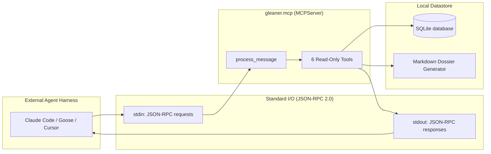

# Model Context Protocol: Zero-Dependency Discovery Tools for Agent Harnesses

Modern software engineering and research workflows increasingly rely on autonomous coding agents
(such as Anthropic's Claude Code, Block's Goose/Buzz, Cursor, and LangGraph multi-agent systems).
While **gleaner** operates as a proactive personal discovery app with its own dashboard and SQLite
datastore, confining its synthesized intelligence solely to a web UI prevents external developer
tools from leveraging verified findings during active programming sessions.

`gleaner.mcp` provides a lightweight, zero-dependency **Model Context Protocol (MCP)** server over
`stdio` conforming to the official MCP specification (protocol version `2024-11-05`). It exposes a
curated set of **read-only tools**, allowing agent harnesses to query standing questions, living
cited answers, verbatim evidence claims, ranked stories, early Hacker News leads, and research dossiers.



---

## Design Principles and Trust Boundary

1. **Strictly Read-Only Operations**:
   Allowing external agents to write directly to gleaner's database would compromise the local trust
   boundary. All 6 exposed tools perform query and generation operations only. External agents cannot
   inject malicious items, alter interest vectors, or mutate source configurations.

2. **Zero External Dependencies**:
   Rather than pulling in the official TypeScript/Python MCP SDK (which introduces heavy dependencies
   and background event loops), `gleaner.mcp` implements the JSON-RPC 2.0 stdio wire protocol directly
   using Python 3.15 standard library modules (`json`, `sys`, `typing`).

3. **Grounded Verbatim Provenance**:
   When an agent retrieves an answer or evidence claim, the payload includes primary source URLs,
   origin keys (`arxiv:...`, `github:...`), and exact verbatim quotes, ensuring the external model
   cannot hallucinate citations.

---

## File Structure

The module `gleaner/mcp.py` tangles from the following chunk layout:

```python
<<gleaner/mcp.py>>=
<<mcp docstring>>

<<mcp imports>>

<<mcp protocol constants>>

<<mcp tools specification>>


<<mcp server class>>
```

```python
<<mcp docstring>>=
"""Model Context Protocol (MCP) Server for Gleaner (ADR-0003, tasks Y).

Provides a local, zero-dependency JSON-RPC 2.0 stdio server conforming to the Model Context
Protocol specification (version 2024-11-05). Exposes read-only tools so external agent harnesses
(Block Buzz / Goose, Claude Code, Cursor) can query Gleaner's proactive discovery state:
- Standing questions and living cited answers
- Grounded verbatim evidence claims and source citations
- Top-ranked feed items and multi-perspective stories
- Early insights ("Ahead of Hacker News" leads)
- Comprehensive research dossiers (Obsidian/PKM Markdown)
"""
```

```python
<<mcp imports>>=
from __future__ import annotations

import json
import logging
import sys
from typing import IO, Any

from gleaner.db import Database
from gleaner.dossier import generate_dossier
from gleaner.feed import generate_feed
from gleaner.hn_lead import hn_leads

logger = logging.getLogger(__name__)
```

---

## Protocol Constants and Capabilities

The server advertises compliance with MCP specification `2024-11-05` and exposes standard capabilities:

```python
<<mcp protocol constants>>=
MCP_PROTOCOL_VERSION = "2024-11-05"
SERVER_NAME = "gleaner"
SERVER_VERSION = "0.1.0"
```

---

## Tools Specification

The server registers 6 read-only tools defined with JSON Schema input parameters:
1. `gleaner_list_questions`: Lists active research standing questions.
2. `gleaner_get_standing_answer`: Retrieves living answer sentences, confidence, delta, and quotes.
3. `gleaner_search_evidence`: Searches verified claims by keyword or topic.
4. `gleaner_get_feed`: Fetches top-ranked feed items across ranking modes (`balanced`, `deep_dive`, `novelty`).
5. `gleaner_get_hn_leads`: Retrieves early technical insights surfaced days before Hacker News.
6. `gleaner_get_dossier`: Generates a portable, comprehensive research dossier in Markdown.

```python
<<mcp tools specification>>=
# Exposed MCP Tools specification
TOOLS_SPEC = [
    {
        "name": "gleaner_list_questions",
        "description": "List all active standing questions being tracked by gleaner.",
        "inputSchema": {
            "type": "object",
            "properties": {},
        },
    },
    {
        "name": "gleaner_get_standing_answer",
        "description": "Get the latest living cited answer for a standing question, including confidence level, delta (what changed), and grounded verbatim quotes.",
        "inputSchema": {
            "type": "object",
            "properties": {
                "question_id": {
                    "type": "string",
                    "description": "The ID of the standing question (e.g. 'q-1', 'q-stack').",
                },
            },
            "required": ["question_id"],
        },
    },
    {
        "name": "gleaner_search_evidence",
        "description": "Search verified verbatim evidence quotes and claims stored in gleaner by topic or keyword.",
        "inputSchema": {
            "type": "object",
            "properties": {
                "query": {
                    "type": "string",
                    "description": "Search query or keywords.",
                },
                "limit": {
                    "type": "integer",
                    "description": "Maximum number of claims to return (default: 5).",
                },
            },
            "required": ["query"],
        },
    },
    {
        "name": "gleaner_get_feed",
        "description": "Get top-ranked intelligence and story cards filtered and scored by Meta Llama.",
        "inputSchema": {
            "type": "object",
            "properties": {
                "limit": {
                    "type": "integer",
                    "description": "Number of cards to return (default: 5).",
                },
                "mode": {
                    "type": "string",
                    "description": "Ranking mode: 'balanced', 'deep_dive', or 'novelty' (default: 'balanced').",
                },
            },
        },
    },
    {
        "name": "gleaner_get_hn_leads",
        "description": "Get early technical insights surfaced on followed sources days before appearing on Hacker News.",
        "inputSchema": {
            "type": "object",
            "properties": {
                "limit": {
                    "type": "integer",
                    "description": "Number of leads to return (default: 5).",
                },
            },
        },
    },
    {
        "name": "gleaner_get_dossier",
        "description": "Generate a comprehensive, portable research dossier in Markdown format containing all standing answers, evidence citations, story cards, and early leads.",
        "inputSchema": {
            "type": "object",
            "properties": {},
        },
    },
]
```

---

## The MCP Server Core

`MCPServer` manages the SQLite database connection, dispatches JSON-RPC requests, executes tools,
and manages standard I/O stream serialization.

```python
<<mcp server class>>=
class MCPServer:
    """Read-only Model Context Protocol server over stdio for Gleaner.

    Attributes:
        db: Database the tools read from.
    """

    def __init__(self, db: Database) -> None:
        """Bind the server to a database.

        Args:
            db: Database the tools read from.
        """
        self.db = db

    <<mcp message dispatcher>>

    <<mcp tool dispatcher>>

    <<mcp tool list questions>>

    <<mcp tool get standing answer>>

    <<mcp tool search evidence>>

    <<mcp tool get feed>>

    <<mcp tool get hn leads>>

    <<mcp tool get dossier>>

    <<mcp stream processing>>

    <<mcp run stdio>>
```

---

## JSON-RPC 2.0 Message Dispatcher

The dispatcher handles the standard protocol lifecycle:
- `initialize`: returns protocol version, server capabilities, and server info.
- `notifications/initialized`: client acknowledgment; yields no response.
- `ping`: returns an empty result object to confirm connection liveness.
- `tools/list`: returns the registered tool schemas.
- `tools/call`: forwards execution to `_handle_tool_call`.
- Unknown methods trigger JSON-RPC error code `-32601` ("Method not found").

```python
<<mcp message dispatcher>>=
def process_message(self, req: dict[str, Any]) -> dict[str, Any] | None:
    """Process a single JSON-RPC 2.0 message.

    Args:
        req: Decoded JSON-RPC request or notification.

    Returns:
        The JSON-RPC response, or None for a notification that needs no response.
    """
    method = req.get("method")
    msg_id = req.get("id")

    # 1. Notifications (no response): JSON-RPC never answers a message without an id
    if method == "notifications/initialized" or "id" not in req:
        return None

    # 2. Ping
    if method == "ping":
        return {"jsonrpc": "2.0", "id": msg_id, "result": {}}

    # 3. Initialize
    if method == "initialize":
        return {
            "jsonrpc": "2.0",
            "id": msg_id,
            "result": {
                "protocolVersion": MCP_PROTOCOL_VERSION,
                "capabilities": {
                    "tools": {},
                },
                "serverInfo": {
                    "name": SERVER_NAME,
                    "version": SERVER_VERSION,
                },
            },
        }

    # 4. Tools list
    if method == "tools/list":
        return {
            "jsonrpc": "2.0",
            "id": msg_id,
            "result": {
                "tools": TOOLS_SPEC,
            },
        }

    # 5. Tools call
    if method == "tools/call":
        params = req.get("params", {})
        tool_name = params.get("name")
        args = params.get("arguments", {})
        return self._handle_tool_call(msg_id, tool_name, args)

    # Unknown method error (-32601)
    return {
        "jsonrpc": "2.0",
        "id": msg_id,
        "error": {
            "code": -32601,
            "message": f"Method not found: {method}",
        },
    }
```

---

## Tool Execution Dispatcher

Each tool execution is guarded with error capture to prevent unhandled exceptions from terminating
the stdio session. If a tool fails, it returns an MCP error response (`isError: true`) with the
exception message.

```python
<<mcp tool dispatcher>>=
def _handle_tool_call(self, msg_id: Any, tool_name: str | None, args: dict[str, Any]) -> dict[str, Any]:
    """Run one tool and wrap its text in a JSON-RPC response.

    An unknown tool or a failing one comes back as an `isError` result, never an exception,
    so one bad call can't end the stdio session.

    Args:
        msg_id: JSON-RPC id of the request, echoed in the response.
        tool_name: Name of the tool to run.
        args: The tool's arguments from the request.

    Returns:
        The JSON-RPC response with the tool's text content.
    """
    try:
        if tool_name == "gleaner_list_questions":
            res = self._tool_list_questions()
        elif tool_name == "gleaner_get_standing_answer":
            res = self._tool_get_standing_answer(str(args.get("question_id", "")))
        elif tool_name == "gleaner_search_evidence":
            res = self._tool_search_evidence(str(args.get("query", "")), int(args.get("limit", 5)))
        elif tool_name == "gleaner_get_feed":
            res = self._tool_get_feed(int(args.get("limit", 5)), str(args.get("mode", "balanced")))
        elif tool_name == "gleaner_get_hn_leads":
            res = self._tool_get_hn_leads(int(args.get("limit", 5)))
        elif tool_name == "gleaner_get_dossier":
            res = self._tool_get_dossier()
        else:
            return {
                "jsonrpc": "2.0",
                "id": msg_id,
                "result": {
                    "content": [{"type": "text", "text": f"Unknown tool: {tool_name}"}],
                    "isError": True,
                },
            }

        return {
            "jsonrpc": "2.0",
            "id": msg_id,
            "result": {
                "content": [{"type": "text", "text": res}],
            },
        }
    except Exception as exc:
        logger.exception("Error executing MCP tool %s: %s", tool_name, exc)
        return {
            "jsonrpc": "2.0",
            "id": msg_id,
            "result": {
                "content": [{"type": "text", "text": f"Error executing tool {tool_name}: {exc}"}],
                "isError": True,
            },
        }
```

---

## Tool Handlers

### 1. Listing Standing Questions
External agents query which technical topics the user is monitoring:

```python
<<mcp tool list questions>>=
def _tool_list_questions(self) -> str:
    """Return the active standing questions as JSON."""
    questions = self.db.list_questions()
    data = [
        {
            "id": q.id,
            "text": q.text,
            "active": q.active,
            "watch": q.watch,
            "linked_interests": q.linked_interests,
        }
        for q in questions
    ]
    return json.dumps(data, indent=2)
```

### 2. Retrieving Living Cited Answers
Returns current answer sentences with granular claim identifiers, stance, and verbatim quotes:

```python
<<mcp tool get standing answer>>=
def _tool_get_standing_answer(self, question_id: str) -> str:
    """Return a question's latest answer, its cited quotes and its claims as JSON.

    Args:
        question_id: Id of the standing question.

    Returns:
        The answer as JSON, or a JSON error object when the question has no answer yet.
    """
    latest = self.db.get_latest_answer(question_id)
    if not latest:
        return json.dumps({"error": f"No answer found for question '{question_id}'."})

    claims = self.db.list_claims_for_question(question_id)
    claim_map = {c.id: c for c in claims}

    data = {
        "question_id": latest.question_id,
        "version": latest.version,
        "confidence": latest.confidence,
        "what_changed": latest.what_changed,
        "what_changed_by": latest.what_changed_by,
        "synthesized_by": latest.synthesized_by,
        "sentences": [
            {
                "text": s.text,
                "claim_ids": s.claim_ids,
                "citations": [
                    {
                        "id": cid,
                        "quote": claim_map[cid].quote if cid in claim_map else "",
                        "origin_key": claim_map[cid].origin_key if cid in claim_map else "",
                        "stance": claim_map[cid].stance if cid in claim_map else "",
                    }
                    for cid in s.claim_ids
                    if cid in claim_map
                ],
            }
            for s in latest.sentences
        ],
        "claims": [
            {
                "id": c.id,
                "text": c.text,
                "quote": c.quote,
                "stance": c.stance,
                "origin_key": c.origin_key,
                "model": c.model,
            }
            for c in claims
        ],
    }
    return json.dumps(data, indent=2)
```

### 3. Semantic Evidence Search
Searches stored verbatim quotes across all questions by keyword matching:

```python
<<mcp tool search evidence>>=
def _tool_search_evidence(self, query: str, limit: int = 5) -> str:
    """Return claims whose text or quote contains the query, as JSON.

    Args:
        query: Case-insensitive substring to match.
        limit: Maximum number of claims to return.

    Returns:
        The matching claims as a JSON list.
    """
    q_norm = query.strip().lower()
    questions = self.db.list_questions()
    matched_claims = []
    for q in questions:
        for c in self.db.list_claims_for_question(q.id):
            if q_norm in c.text.lower() or q_norm in c.quote.lower():
                matched_claims.append({
                    "id": c.id,
                    "question_id": c.question_id,
                    "text": c.text,
                    "quote": c.quote,
                    "stance": c.stance,
                    "origin_key": c.origin_key,
                    "model": c.model,
                })
                if len(matched_claims) >= limit:
                    break
        if len(matched_claims) >= limit:
            break
    return json.dumps(matched_claims, indent=2)
```

### 4. Top-Ranked Intelligence Feed
Exposes the multi-factor scoring cascade (relevance, novelty, quality, momentum):

```python
<<mcp tool get feed>>=
def _tool_get_feed(self, limit: int = 5, mode: str = "balanced") -> str:
    """Return the top feed cards with their score components as JSON.

    Args:
        limit: Number of cards to return.
        mode: Ranking mode passed to `generate_feed`.

    Returns:
        The cards as a JSON list.
    """
    cards = generate_feed(self.db, limit=limit, mode=mode)
    data = [
        {
            "id": c.item.id,
            "title": c.item.title,
            "url": c.item.url,
            "source_id": c.item.source_id,
            "kind": c.item.kind,
            "score": c.score,
            "relevance": c.components.relevance,
            "novelty": c.components.novelty,
            "quality": c.components.quality,
            "why": c.why,
            "summary": c.summary,
            "perspectives": c.perspectives,
            "also_covered_by": c.also_covered_by,
        }
        for c in cards
    ]
    return json.dumps(data, indent=2)
```

### 5. Early Hacker News Leads
Surfaces items discovered on primary sources days before appearing on social aggregators:

```python
<<mcp tool get hn leads>>=
def _tool_get_hn_leads(self, limit: int = 5) -> str:
    """Return items seen before they reached Hacker News, with the lead time, as JSON.

    Args:
        limit: Number of leads to return.

    Returns:
        The leads as a JSON list.
    """
    leads = hn_leads(self.db, limit=limit)
    data = [
        {
            "title": lead.item.title,
            "url": lead.item.url,
            "lead_seconds": lead.lead.total_seconds(),
            "lead_formatted": (
                f"{lead.lead.total_seconds() / 86400.0:.1f} days"
                if lead.lead.total_seconds() >= 86400
                else f"{lead.lead.total_seconds() / 3600.0:.1f} hours"
            ),
            "hn_url": lead.hn_url,
            "hn_points": lead.points,
        }
        for lead in leads[:limit]
    ]
    return json.dumps(data, indent=2)
```

### 6. Portable Research Dossier
Synthesizes the complete intelligence state into an Obsidian/PKM-compatible document:

```python
<<mcp tool get dossier>>=
def _tool_get_dossier(self) -> str:
    """Return the research dossier as Markdown."""
    return generate_dossier(self.db)
```

---

## Standard I/O Stream Loop

The server reads newline-delimited JSON-RPC messages from `stdin` and writes JSON responses to `stdout`.
Malformed JSON lines are caught and returned with standard JSON-RPC error code `-32700` ("Parse error").

```python
<<mcp stream processing>>=
def process_stream(self, stdin: IO[str], stdout: IO[str]) -> None:
    """Process JSON-RPC messages line by line over streams.

    A line that isn't valid JSON gets a parse error (-32700), one that isn't an object an invalid
    request error (-32600), and a message that fails an internal error (-32603). The loop goes on.

    Args:
        stdin: Stream of newline-delimited JSON-RPC messages.
        stdout: Stream the responses are written to, one per line.
    """
    for line in stdin:
        line = line.strip()
        if not line:
            continue
        try:
            req = json.loads(line)
        except json.JSONDecodeError as exc:
            err_resp = {
                "jsonrpc": "2.0",
                "id": None,
                "error": {"code": -32700, "message": f"Parse error: {exc}"},
            }
            stdout.write(json.dumps(err_resp) + "\n")
            stdout.flush()
            continue

        if not isinstance(req, dict):
            resp: dict[str, Any] | None = {
                "jsonrpc": "2.0",
                "id": None,
                "error": {"code": -32600, "message": "Invalid Request: expected a JSON object"},
            }
        else:
            try:
                resp = self.process_message(req)
            except Exception as exc:  # noqa: BLE001 - one bad message must not end the server
                resp = {
                    "jsonrpc": "2.0",
                    "id": req.get("id"),
                    "error": {"code": -32603, "message": f"Internal error: {exc}"},
                }
        if resp is not None:
            stdout.write(json.dumps(resp) + "\n")
            stdout.flush()
```

The CLI entrypoint `gleaner mcp` invokes `run_stdio`:

```python
<<mcp run stdio>>=
def run_stdio(self) -> None:
    """Run MCP server listening on sys.stdin and writing to sys.stdout."""
    self.process_stream(sys.stdin, sys.stdout)
```

---

## Verification

The behavior of `gleaner.mcp` is verified by the offline pytest suite in `tests/test_mcp.py`:

- Handshake and protocol negotiation: `test_mcp_initialize` and `test_mcp_ping`.
- Tool schema discovery: `test_mcp_tools_list`.
- Standing question inspection: `test_mcp_tool_call_list_questions` and `test_mcp_tool_call_get_standing_answer`.
- Verbatim evidence search: `test_mcp_tool_call_search_evidence`.
- Multi-factor feed scoring retrieval: `test_mcp_tool_call_get_feed`.
- Full research dossier generation: `test_mcp_tool_call_get_dossier`.
- JSON-RPC error handling and invalid tool names: `test_mcp_error_handling`.

---

## Maintenance Notes

- **Protocol Versioning**: If Anthropic or the MCP Working Group releases updates beyond `2024-11-05`,
  update `MCP_PROTOCOL_VERSION` and verify schema compatibility.
- **Strict Read-Only Guarantee**: Never add state-mutating tools (such as deleting items or updating
  sources) to `TOOLS_SPEC` without explicit human confirmation gates.
- **Output Size Limits**: For very large databases, `gleaner_get_feed` and `gleaner_search_evidence`
  accept explicit `limit` parameters to keep stdio payloads responsive.

---

## Chunk Index

- `<<gleaner/mcp.py>>`: Root tangle destination.
- `<<mcp docstring>>`: Module documentation and purpose.
- `<<mcp imports>>`: Standard library and gleaner imports.
- `<<mcp protocol constants>>`: MCP protocol version and server metadata.
- `<<mcp tools specification>>`: JSON schema definitions for the 6 read-only tools.
- `<<mcp server class>>`: `MCPServer` definition and class layout.
- `<<mcp message dispatcher>>`: JSON-RPC 2.0 lifecycle dispatcher.
- `<<mcp tool dispatcher>>`: Tool call routing and error boundary.
- `<<mcp tool list questions>>`: `gleaner_list_questions` implementation.
- `<<mcp tool get standing answer>>`: `gleaner_get_standing_answer` implementation.
- `<<mcp tool search evidence>>`: `gleaner_search_evidence` implementation.
- `<<mcp tool get feed>>`: `gleaner_get_feed` implementation.
- `<<mcp tool get hn leads>>`: `gleaner_get_hn_leads` implementation.
- `<<mcp tool get dossier>>`: `gleaner_get_dossier` implementation.
- `<<mcp stream processing>>`: `process_stream` stdio line reader.
- `<<mcp run stdio>>`: `run_stdio` entrypoint.
