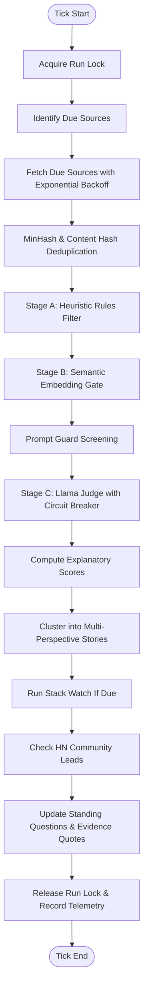

# Workflows: The Ingestion, Triage, and Living-Answer Pipeline

The collect workflow is the central nervous system of gleaner. It periodically awakens,
queries active information sources (arXiv, GitHub releases, Hacker News, RSS/Atom feeds),
deduplicates content, applies our multi-stage filtering cascade, runs Prompt Guard defense,
judges relevance with Meta's Llama models, assigns articles to stories, scores items, and updates
user standing questions with verified evidence.

`gleaner.workflows` coordinates this pipeline with four strict operational invariants:

1. **Source Isolation**: A failure in one external endpoint (e.g. an arXiv 503 or an expired RSS SSL certificate)
   increments backoff for that specific source and logs the error, but **never** interrupts the tick or prevents
   other sources from being fetched.
2. **Mutual Exclusion (Run Locks)**: Only one collection tick may execute at a time against a database instance,
   preventing duplicate API queries and SQLite write contention.
3. **Circuit-Broken Judging**: If an LLM endpoint fails or times out, the tick records `judge_degraded=True`
   and continues scoring items using vector embeddings alone; degraded items are never marked as LLM-judged.
4. **End-to-End Integrity**: Kept items immediately feed downstream analytical subsystems: Stack Watch
   dependency security alerts, Hacker News discovery lead tracking, and standing questions.



---

## File Structure

The file `gleaner/workflows.py` is tangles from the following structure:

```python
<<gleaner/workflows.py>>=
<<workflows module docstring>>

<<workflows imports>>

<<workflows constants>>


<<source due check function>>


<<run lock management functions>>


<<collect tick main loop function>>


<<fetch source on demand function>>


<<process and score items function>>


<<source feedback counts helper>>


<<graphflow declarative workflow>>
```

```python
<<workflows module docstring>>=
"""Graphflow workflows and runners for discovery feed."""
```

```python
<<workflows imports>>=
from __future__ import annotations

import asyncio
import json
import logging
from collections.abc import Callable
from datetime import UTC, datetime, timedelta
from typing import Any

import httpx
from graphflow import Application, Field, State, Workflow

from gleaner.config import SourceConfig
from gleaner.db import Database
from gleaner.dedupe import adopt_stored, dedupe_items
from gleaner.embed import Embedder, FakeEmbedder
from gleaner.filters import filter_embedding_gate, filter_rules
from gleaner.hn_lead import check_hn_sightings
from gleaner.judge import (
    JudgeStats,
    JudgeUnavailableError,
    fallback_judgment,
    get_cached_judgment,
    judge_item,
)
from gleaner.learn import source_feedback_counts
from gleaner.models import Item, SourceRow
from gleaner.questions import update_standing_answers
from gleaner.scoring import score_item
from gleaner.security import screen_prompt_guard
from gleaner.sources import get_connector
from gleaner.stack_watch import STACK_SOURCE_ID, run_stack_watch_if_due
from gleaner.stories import assign_to_story
```

```python
<<workflows constants>>=
logger = logging.getLogger(__name__)

# Stage A's length floor. The spec's 200 chars is for full article text, but Stage A
# sees the feed summary (full text is fetched only after the cheap filters, spec M3)
# and RSS summaries are routinely shorter, so only near-empty items are dropped here.
MIN_SUMMARY_LENGTH = 10
```

---

## Source Scheduling and Polling Cadence

Each source defines a polling cadence `cadence_s` (e.g. 3600 seconds for blogs, 14400 for arXiv).
When a fetch fails, `failures` increments and the next attempt waits an exponential backoff,
with the exponent capped at 6 (so at most 64 cadences; there is no fixed 24-hour ceiling):

$$\text{wait} = \text{cadence\_s} \times 2^{\min(\text{failures},\ 6)}$$

```python
<<source due check function>>=
def is_source_due(src: SourceRow, current_time: datetime | None = None) -> bool:
    """Check if a source is due for collection.

    Args:
        src: The source; one never collected is always due. Naive times are UTC.
        current_time: The reference time; defaults to the current UTC time.

    Returns:
        Whether the source's next due time has passed.
    """
    if src.next_due_at is None:
        return True
    if current_time is None:
        current_time = datetime.now(UTC)
    if src.next_due_at.tzinfo is None:
        src_due = src.next_due_at.replace(tzinfo=UTC)
    else:
        src_due = src.next_due_at
    if current_time.tzinfo is None:
        current_time = current_time.replace(tzinfo=UTC)
    return src_due <= current_time
```

---

## Run Lock Management

Run locks are stored in the SQLite `runs` table to ensure single-writer safety across async tasks
and CLI invocations. The check and the insert run in one `BEGIN IMMEDIATE` transaction: SQLite
takes its write lock at `BEGIN`, so a second process blocks there and then sees the first one's
row. Without it, two processes could both pass the check before either inserted (37 of 200
two-thread trials did, `tests/test_run_locks.py`). A `running` row older than 15 minutes counts
as a crashed run and no longer blocks; every caller releases its lock however the tick ends,
including a cancel or Ctrl-C.

```python
<<run lock management functions>>=
def acquire_run_lock(
    db: Database,
    run_id: str,
    workflow: str = "collect",
    stale_timeout_minutes: int = 15,
) -> bool:
    """Acquire an execution lock in the runs table to prevent concurrent ticks.

    Args:
        db: The gleaner database.
        run_id: The id of the run taking the lock.
        workflow: The workflow name the lock is for.
        stale_timeout_minutes: A running run older than this no longer holds the lock.

    Returns:
        True if the lock was taken (a ``running`` row was inserted), False if another run holds it.
    """
    now = datetime.now(UTC)
    stale_cutoff = now - timedelta(minutes=stale_timeout_minutes)

    with db.connect() as conn:
        if not conn.in_transaction:
            conn.execute("BEGIN IMMEDIATE;")
        active = conn.execute(
            "SELECT * FROM runs WHERE workflow = ? AND status = 'running' AND started_at >= ?;",
            (workflow, stale_cutoff.isoformat()),
        ).fetchone()

        if active is not None:
            return False

        conn.execute(
            """
        INSERT INTO runs (id, workflow, started_at, finished_at, status, stats, errors)
        VALUES (?, ?, ?, NULL, 'running', NULL, NULL);
        """,
            (run_id, workflow, now.isoformat()),
        )
        return True


def release_run_lock(
    db: Database,
    run_id: str,
    status: str = "finished",
    stats: dict[str, Any] | None = None,
    errors: dict[str, Any] | None = None,
) -> None:
    """Release a run lock by updating its final status and statistics.

    Args:
        db: The gleaner database.
        run_id: The id of the run holding the lock.
        status: The run's final status.
        stats: The run's statistics, stored as JSON.
        errors: The run's errors, stored as JSON.
    """
    now = datetime.now(UTC)
    with db.connect() as conn:
        conn.execute(
            """
        UPDATE runs
        SET status = ?, finished_at = ?, stats = ?, errors = ?
        WHERE id = ?;
        """,
            (
                status,
                now.isoformat(),
                json.dumps(stats or {}),
                json.dumps(errors or {}),
                run_id,
            ),
        )
```

---

## The Collection Tick: `run_collect_tick`

`run_collect_tick` is the asynchronous orchestrator. It fetches due sources one after another (polite: one
request at a time), deduplicates each batch, processes items through triage, and triggers downstream
standing question updates:

```python
<<collect tick main loop function>>=
async def run_collect_tick(
    db: Database,
    client: httpx.AsyncClient | None = None,
    model: Any | None = None,
    embedder: Embedder | None = None,
    writer: Any | None = None,
    answer_model: Any | None = None,
    progress_callback: Callable[[str, str, dict[str, Any] | None], None] | None = None,
    force: bool = False,
) -> dict[str, Any]:
    """Execute one collection tick across all due sources (every enabled source when forced).

    Polite, resilient: one source failure increments backoff and never crashes the tick.
    `model=None` judges heuristically and never touches a Llama endpoint (tests, --offline,
    demo); live callers pass `get_llama_model("judge")`. `writer` (a small Llama is enough)
    words each changed answer's "what changed" line. When `answer_model` is passed (e.g. Muse Spark),
    it synthesizes the full grounded living answers.

    Args:
        db: The gleaner database.
        client: HTTP client for the connectors; one is created (and closed) when None.
        model: The judge model, or None to judge heuristically.
        embedder: The embedder; defaults to a ``FakeEmbedder``.
        writer: The model that words each "what changed" line.
        answer_model: The model that synthesizes living answers.
        progress_callback: Called as ``(stage, message, payload)`` at each stage; its failures
            are logged and ignored.
        force: Read every enabled source now, not only the due ones (the Collect button).

    Returns:
        Tick stats: ``sources_run``, ``items_stored``, ``sources_failed``, ``errors`` (by source
        id), the standing-answer counts and ``telemetry``. With no due source, only the first three.
    """
    def report_progress(stage: str, message: str, payload: dict[str, Any] | None = None) -> None:
        """Pass a progress event to ``progress_callback``, if any; never raises."""
        if progress_callback:
            try:
                progress_callback(stage, message, payload)
            except Exception as exc:  # noqa: BLE001
                logger.debug("Progress callback failed: %s", exc)

    if embedder is None:
        embedder = FakeEmbedder(dim=db.vec_dim)

    now = datetime.now(UTC)
    all_sources = db.list_sources()
    # the scheduler waits for each source's cadence; the Collect button (force) reads them all now
    due_sources = [s for s in all_sources if s.enabled and s.id != STACK_SOURCE_ID and (force or is_source_due(s, now))]

    if not due_sources:
        report_progress("idle", "No sources currently due for collection.")
        return {"sources_run": 0, "items_stored": 0, "sources_failed": 0}

    report_progress(
        "due_sources",
        f"Found {len(due_sources)} due sources: {', '.join(s.id for s in due_sources)}",
        {"due_count": len(due_sources)},
    )

    stats = {
        "sources_run": len(due_sources),
        "items_stored": 0,
        "sources_failed": 0,
        "errors": {},
    }

    tick_telemetry = {
        "fetched": 0,
        "deduped": 0,
        "dropped_stage_a": 0,
        "dropped_stage_b": 0,
        "passed_vectors": 0,
        "blocked_prompt_guard": 0,
        "dropped_language": 0,
        "judged_llama": 0,
        "llm_calls": 0,
        "llm_tokens": 0,
        "judge_degraded": False,
        "scored": 0,
        "compute_saved_pct": 0.0,
    }

    own_client = False
    if client is None:
        client = httpx.AsyncClient(timeout=30.0)
        own_client = True

    tick_item_ids: list[str] = []
    try:
        for src in due_sources:
            try:
                connector = get_connector(src.type)
                cfg = SourceConfig(
                    id=src.id,
                    type=src.type,
                    params=src.params,
                    cadence_s=src.cadence_s,
                    trust=src.trust,
                )
                res = await connector.fetch(
                    cfg,
                    since=None,
                    client=client,
                    etag=src.etag,
                    last_modified=src.last_modified,
                )

                if res.items:
                    tick_telemetry["fetched"] += len(res.items)
                    deduped = adopt_stored(db, dedupe_items(res.items))
                    tick_telemetry["deduped"] += len(deduped)
                    for item in deduped:
                        db.upsert_item(item)
                    tick_item_ids.extend(item.id for item in deduped)
                    # judging is synchronous model calls: run it off the event loop so the
                    # server keeps answering (and streaming progress) during a long tick
                    proc_res = await asyncio.to_thread(
                        process_and_score_items,
                        db,
                        deduped,
                        embedder=embedder,
                        model=model,
                        source_trust=src.trust,
                        # once the judge is down, later sources in this tick don't retry it
                        judge_degraded=tick_telemetry["judge_degraded"],
                    )
                    stats["items_stored"] += len(deduped)
                    sub_telem = proc_res.get("telemetry", {})
                    for k in (
                        "dropped_stage_a",
                        "dropped_stage_b",
                        "passed_vectors",
                        "blocked_prompt_guard",
                        "dropped_language",
                        "judged_llama",
                        "llm_calls",
                        "llm_tokens",
                        "scored",
                    ):
                        tick_telemetry[k] += sub_telem.get(k, 0)
                    tick_telemetry["judge_degraded"] |= bool(sub_telem.get("judge_degraded"))

                # Reset failure count and update next due time
                src.failures = 0
                if res.etag:
                    src.etag = res.etag
                if res.last_modified:
                    src.last_modified = res.last_modified
                src.next_due_at = now + timedelta(seconds=src.cadence_s)
                db.upsert_source(src)

                # Log fetch
                with db.connect() as conn:
                    conn.execute(
                        "INSERT INTO fetch_log (source_id, fetched_at, status_code, item_count, error) VALUES (?, ?, ?, ?, ?);",
                        (src.id, now.isoformat(), 200, len(res.items), None),
                    )

            except Exception as e:  # noqa: BLE001 - per-source isolation: any fetch failure is logged and backs off
                stats["sources_failed"] += 1
                stats["errors"][src.id] = str(e)

                src.failures += 1
                backoff_factor = 2 ** min(src.failures, 6)
                src.next_due_at = now + timedelta(seconds=src.cadence_s * backoff_factor)
                db.upsert_source(src)

                with db.connect() as conn:
                    conn.execute(
                        "INSERT INTO fetch_log (source_id, fetched_at, status_code, item_count, error) VALUES (?, ?, ?, ?, ?);",
                        (src.id, now.isoformat(), 500, 0, str(e)),
                    )

        # Stack watch (M17 step 8): advisories for the watched project's installed versions, daily
        report_progress("stack_watch", "Checking stack dependency vulnerabilities (OSV)...")
        tick_item_ids.extend(await run_stack_watch_if_due(db, client, now))
        # HN lead: were recent kept items posted to Hacker News after their source published them?
        try:
            report_progress("hn_sightings", "Checking Hacker News sightings for early insight lead...")
            await check_hn_sightings(db, client, now=now)
        except Exception as exc:  # noqa: BLE001 - a side measurement: it must not lose the collected items
            logger.warning("HN lead not checked this tick: %s", exc)
    finally:
        if own_client:
            await client.aclose()

    # Standing questions (M17): new evidence from this tick's kept items updates the answers
    try:
        # a judge that failed this tick isn't asked for claims either: keyword matching stands in
        judge = None if tick_telemetry["judge_degraded"] else model
        report_progress("standing_answers", "Updating standing questions and living answers...")
        stats.update(
            await asyncio.to_thread(
                update_standing_answers, db, tick_item_ids, model=judge, writer=writer, answer_model=answer_model
            )
        )
    except Exception as exc:  # noqa: BLE001 - answers are a downstream view: a failure must not lose the collected items
        logger.warning("Standing answers not updated this tick: %s", exc)
        stats.update(claims_added=0, answers_changed=0)

    # Aggregate compute saved metric for this tick
    if tick_telemetry["fetched"] > 0:
        saved = tick_telemetry["fetched"] - tick_telemetry["judged_llama"]
        pct = round((max(0, saved) / tick_telemetry["fetched"]) * 100, 1)
        tick_telemetry["compute_saved_pct"] = pct
        db.set_telemetry("latest", tick_telemetry)
    else:
        tick_telemetry["compute_saved_pct"] = None
        # Preserve previous valid latest telemetry if one exists with measured data
        prev = db.get_telemetry("latest")
        if not prev or prev.get("fetched", 0) == 0:
            db.set_telemetry("latest", tick_telemetry)
    stats["telemetry"] = tick_telemetry

    report_progress("complete", f"Collection tick complete: {stats['items_stored']} items stored.", {"stats": stats})
    return stats
```

---

## On-Demand Source Ingestion: `fetch_source_on_demand`

Allows users to immediately trigger an on-demand refresh of a specific source from the UI or CLI:

```python
<<fetch source on demand function>>=
async def fetch_source_on_demand(
    db: Database,
    source: SourceRow,
    client: httpx.AsyncClient | None = None,
    embedder: Embedder | None = None,
    model: Any | None = None,
) -> dict[str, Any]:
    """Execute an immediate, on-demand fetch and processing for a single source.

    Args:
        db: The gleaner database.
        source: The source to fetch; its backoff, cache headers and next due time are updated.
        client: HTTP client for the connector; one is created (and closed) when None.
        embedder: The embedder; defaults to a ``FakeEmbedder``.
        model: The judge model, or None to judge heuristically.

    Returns:
        ``status``, ``source_id``, ``items_fetched`` and ``items_stored``.

    Raises:
        Exception: Whatever the fetch or processing raised, after the failure is logged and the
            source backed off.
    """
    own_client = False
    if client is None:
        client = httpx.AsyncClient(timeout=30.0)
        own_client = True

    now = datetime.now(UTC)
    try:
        connector = get_connector(source.type)
        cfg = SourceConfig(
            id=source.id,
            type=source.type,
            params=source.params,
            cadence_s=source.cadence_s,
            trust=source.trust,
        )
        res = await connector.fetch(
            cfg,
            since=None,
            client=client,
            etag=source.etag,
            last_modified=source.last_modified,
        )

        items_stored = 0
        if res.items:
            deduped = adopt_stored(db, dedupe_items(res.items))
            for item in deduped:
                db.upsert_item(item)
            process_and_score_items(
                db,
                deduped,
                embedder=embedder,
                model=model,
                source_trust=source.trust,
            )
            items_stored = len(deduped)

        source.failures = 0
        if res.etag:
            source.etag = res.etag
        if res.last_modified:
            source.last_modified = res.last_modified
        source.next_due_at = now + timedelta(seconds=source.cadence_s)
        db.upsert_source(source)

        with db.connect() as conn:
            conn.execute(
                "INSERT INTO fetch_log (source_id, fetched_at, status_code, item_count, error) VALUES (?, ?, ?, ?, ?);",
                (source.id, now.isoformat(), 200, len(res.items), None),
            )

        return {
            "status": "success",
            "source_id": source.id,
            "items_fetched": len(res.items),
            "items_stored": items_stored,
        }
    except Exception as e:
        source.failures += 1
        backoff_factor = 2 ** min(source.failures, 6)
        source.next_due_at = now + timedelta(seconds=source.cadence_s * backoff_factor)
        db.upsert_source(source)

        with db.connect() as conn:
            conn.execute(
                "INSERT INTO fetch_log (source_id, fetched_at, status_code, item_count, error) VALUES (?, ?, ?, ?, ?);",
                (source.id, now.isoformat(), 500, 0, str(e)),
            )
        raise e
    finally:
        if own_client:
            await client.aclose()
```

---

## Pipeline Triage Cascade: `process_and_score_items`

The core data processing node:
1. Applies Stage A exclusions, clickbait rules, and minimum length checks.
2. Computes embeddings and runs the Stage B semantic gate.
3. Screens with Prompt Guard.
4. Invokes the Llama judge (or falls back if unavailable).
5. Projects scores through `score_item`.
6. Clusters items into multi-source story cards.

```python
<<process and score items function>>=
def process_and_score_items(
    db: Database,
    items: list[Item],
    embedder: Embedder | None = None,
    model: Any | None = None,
    source_trust: float = 0.5,
    judge_degraded: bool = False,
) -> dict[str, Any]:
    """Embed, cluster into stories, filter (Stage A/B), judge and score a batch.

    Circuit breaker: after the first failed judge model call (or when started with
    ``judge_degraded=True``) the model is not called again for this batch; the rest
    is scored embedding-only and the telemetry says ``judge_degraded: True``.

    Args:
        db: The gleaner database.
        items: The deduplicated items, already stored.
        embedder: The embedder; defaults to a ``FakeEmbedder``.
        model: The judge model, or None to judge heuristically.
        source_trust: The items' source trust, for the quality score.
        judge_degraded: Start with the judge already marked down.

    Returns:
        ``kept``, ``dropped`` and the batch ``telemetry``.
    """
    if embedder is None:
        embedder = FakeEmbedder(dim=db.vec_dim)
    if db.sync_embedder(embedder.model_id):
        logger.warning("Embedding model changed to %s: stored vectors dropped and re-embedded", embedder.model_id)

    # Load active interests and exclusions
    exclusions: list[str] = []
    interest_tuples: list[tuple[str, list[float], float]] = []
    interest_weights: dict[str, float] = {}
    profile_version = 1

    with db.connect() as conn:
        int_rows = conn.execute("SELECT * FROM interests WHERE active = 1;").fetchall()
        if int_rows:
            profile_version = max((r["profile_version"] for r in int_rows), default=1)
        for r in int_rows:
            int_id = r["id"]
            exc = json.loads(r["exclusions"]) if r["exclusions"] else []
            exclusions.extend(exc)
            weight = float(r["weight"])
            # Task L: Read learned centroid vector if present
            stored_v = db.get_interest_vector(int_id)
            if stored_v is None:
                text_q = f"search_query: {r['label']} {r['description']} {' '.join(json.loads(r['keywords'] or '[]'))}"
                stored_v = embedder.embed([text_q])[0]
                db.upsert_interest_vector(int_id, stored_v)
            interest_tuples.append((int_id, stored_v, weight))
            interest_weights[int_id] = weight

    # Task M: Fetch recent seen item vectors for novelty calculation
    recent_seen_vecs: list[list[float]] = []
    with db.connect() as conn:
        # this batch's own earlier scores aren't "seen before": a re-fetched item would score novelty 0
        batch_ids = [it.id for it in items]
        marks = ",".join("?" * len(batch_ids)) or "''"
        recent_rows = conn.execute(
            f"SELECT item_id FROM scores WHERE item_id NOT IN ({marks}) ORDER BY computed_at DESC LIMIT 20;",  # noqa: S608 - only "?" placeholders are interpolated
            batch_ids,
        ).fetchall()
        for rr in recent_rows:
            rv = db.get_item_vector(rr["item_id"])
            if rv:
                recent_seen_vecs.append(rv)

    kept = 0
    dropped_stage_a = 0
    dropped_stage_b = 0
    blocked_prompt_guard = 0
    dropped_language = 0
    passed_vectors = 0
    judge_stats = JudgeStats()
    feedback_counts: dict[str | None, tuple[int, int]] = {}
    now = datetime.now(UTC)

    for item in items:
        vec = embedder.embed([f"search_document: {item.title} {item.text[:500]}"])[0]
        db.upsert_item_vector(item.id, vec)
        assign_to_story(item, vec, db)

        passed_a, _ = filter_rules(item, exclusions=exclusions, min_article_length=MIN_SUMMARY_LENGTH)
        if not passed_a:
            item.status = "dropped_stage_a"
            db.upsert_item(item)
            dropped_stage_a += 1
            continue

        passed_b, sim, matched_interest_id = filter_embedding_gate(item, vec, interest_tuples, threshold=0.15)
        exploring_candidate = False
        if not passed_b:
            if sim >= 0.10:
                # Task Q: Near-miss Stage B borderline candidate preserved for Serendipity
                exploring_candidate = True
            else:
                item.status = "dropped_stage_b"
                db.upsert_item(item)
                dropped_stage_b += 1
                continue

        passed_vectors += 1

        pg_res = screen_prompt_guard(f"{item.title}\n{item.text}")
        if not pg_res.is_safe:
            item.status = "dropped_prompt_guard"
            db.upsert_item(item)
            blocked_prompt_guard += 1
            continue

        item.status = "exploring" if exploring_candidate else "scored"
        db.upsert_item(item)

        # Task B: the judge asks about each active interest
        if judge_degraded:
            judgment = get_cached_judgment(db, item.id, profile_version) or fallback_judgment(
                item, profile_version, why="Judge model unavailable; scored by embeddings only"
            )
        else:
            try:
                judgment = judge_item(
                    item,
                    db,
                    model=model,
                    interests=int_rows,
                    profile_version=profile_version,
                    stats=judge_stats,
                )
            except JudgeUnavailableError as e:
                logger.warning("Judge unavailable; scoring the rest of this batch by embeddings only: %s", e)
                judge_degraded = True
                judgment = fallback_judgment(item, profile_version, why="Judge model unavailable; scored by embeddings only")

        # Task C0: Language screening
        allowed_languages = ["en"]
        item_lang = (judgment.lang or "en").lower()
        lang_changed = item.lang != item_lang
        item.lang = item_lang
        if item_lang not in allowed_languages:
            item.status = "dropped_language"
            db.upsert_item(item)
            dropped_language += 1
            continue
        if lang_changed:
            db.upsert_item(item)

        if judgment.model == "fallback":
            llm_rel = None
        else:
            llm_rel = max(judgment.relevance.values()) if judgment.relevance else None

        # Task O: Opportunities extraction
        if judgment.type == "opportunity" or item.kind == "opportunity":
            from gleaner.opportunities import extract_opportunity

            extract_opportunity(item, db, model=None if judge_degraded else model)

        story_sources = 1
        if item.story_id:
            with db.connect() as conn:
                s_row = conn.execute("SELECT source_count FROM stories WHERE id = ?;", (item.story_id,)).fetchone()
                if s_row:
                    story_sources = int(s_row["source_count"])

        if item.source_id not in feedback_counts:
            feedback_counts[item.source_id] = _source_feedback_counts(db, item.source_id)
        likes, dislikes = feedback_counts[item.source_id]
        # Stage B's sim already includes the interest weight; score_item applies it once, to the blend.
        weight = interest_weights.get(matched_interest_id, 1.0)
        raw_sim = sim / weight if weight > 0 else sim

        sc = score_item(
            item=item,
            item_vec=vec,
            embed_sim=max(0.1, raw_sim),
            llm_relevance=llm_rel,
            # the judge answers relevance only: novelty comes from embeddings, actionability from the kind
            llm_novelty=None,
            judge_actionability=None,
            source_trust=source_trust,
            likes=likes,
            dislikes=dislikes,
            interest_weight=weight,
            story_source_count=story_sources,
            recent_seen_vecs=recent_seen_vecs,
            profile_version=profile_version,
            now=now,
        )
        with db.connect() as conn:
            conn.execute(
                """
            INSERT INTO scores (item_id, profile_version, components, final, computed_at)
            VALUES (?, ?, ?, ?, ?)
            ON CONFLICT(item_id) DO UPDATE SET
                profile_version = excluded.profile_version,
                components = excluded.components,
                final = excluded.final,
                computed_at = excluded.computed_at;
            """,
                (sc.item_id, sc.profile_version, json.dumps(sc.components.model_dump()), sc.final, now.isoformat()),
            )
        kept += 1

    total_dropped = dropped_stage_a + dropped_stage_b + blocked_prompt_guard + dropped_language
    telemetry = {
        "fetched": len(items),
        "deduped": len(items),
        "dropped_stage_a": dropped_stage_a,
        "dropped_stage_b": dropped_stage_b,
        "passed_vectors": passed_vectors,
        "blocked_prompt_guard": blocked_prompt_guard,
        "dropped_language": dropped_language,
        "judged_llama": judge_stats.items,
        "llm_calls": judge_stats.calls,
        "llm_tokens": judge_stats.tokens,
        "judge_degraded": judge_degraded,
        "scored": kept,
        "compute_saved_pct": round((1.0 - (judge_stats.items / max(1, len(items)))) * 100, 1),
    }
    return {"kept": kept, "dropped": total_dropped, "telemetry": telemetry}
```

---

## Source Quality Helper

```python
<<source feedback counts helper>>=
def _source_feedback_counts(db: Database, source_id: str | None) -> tuple[int, int]:
    """Return (likes, dislikes) on this source's items; (0, 0) when there is no source.

    The same counts the learning loop rescores with.
    """
    if source_id is None:
        return 0, 0
    return source_feedback_counts(db, source_id)
```

---

## Graphflow StateGraph Declarative Workflow

For orchestrating the pipeline inside the LangGraph/graphflow declarative execution framework:

```python
<<graphflow declarative workflow>>=
class CollectState(State):
    """State of the collect workflow.

    Attributes:
        due_source_ids: Ids of the sources due for collection.
        item_ids: Ids of the kept (scored or exploring) items; appended to by each node.
        errors: Per-source errors as ``"source_id: message"``; appended to by each node.
        scored_count: How many items are kept.
    """

    due_source_ids: list[str] = Field(default_factory=list)
    item_ids: list[str] = Field.reducer("append")
    errors: list[str] = Field.reducer("append")
    scored_count: int = 0


def build_collect_workflow(
    db: Database,
    client: httpx.AsyncClient | None = None,
    embedder: Embedder | None = None,
    model: Any | None = None,
) -> Application:
    """Build the declarative graphflow Workflow for the collect-and-score pipeline.

    Args:
        db: The gleaner database.
        client: HTTP client for the connectors; one is created per tick when None.
        embedder: The embedder; defaults to a ``FakeEmbedder``.
        model: The judge model, or None to judge heuristically.

    Returns:
        An ``Application`` with the ``collect`` workflow registered.
    """
    wf = Workflow("collect", state_schema=CollectState)

    async def run_pipeline(state: CollectState) -> dict[str, Any]:
        """Run one collection tick and report the kept items and per-source errors."""
        stats = await run_collect_tick(db, client=client, model=model, embedder=embedder)
        with db.connect() as conn:
            rows = conn.execute("SELECT id FROM items WHERE status IN ('scored', 'exploring');").fetchall()
            scored_ids = [r["id"] for r in rows]
        errs = [f"{k}: {v}" for k, v in (stats.get("errors") or {}).items()]
        return {
            "item_ids": scored_ids,
            "errors": errs,
            "scored_count": len(scored_ids),
        }

    wf.then(run_pipeline, name="collect_and_score")
    app = Application("collect_app")
    app.register(wf)
    return app
```

---

## Callers and Verification

### Callers
- `gleaner.cli`: `cmd_collect` invokes `run_collect_tick`.
- `gleaner.server`: `/api/collect` and `/api/sources/{id}/fetch` trigger ingestion.

### Verification
- `tests/test_discovery_collect.py`: `test_collect_workflow_stores_items_and_handles_failures`
  (a failing source backs off, the others are stored), `test_judge_circuit_breaker_stops_calling_a_down_model`.
- `tests/test_discovery_scheduler.py`: `test_collect_run_lock_prevents_overlap`,
  `test_collect_tick_handles_naive_due_times_and_disabled_sources`.
- `tests/test_run_locks.py`: two processes never both hold the lock; a cancel, Ctrl-C or model
  config error releases it; slow judging doesn't freeze the server.

---

## Maintenance Notes

- When modifying parameter signatures of `run_collect_tick`, ensure all call sites (`cli.py`, `server.py`, `tests`)
  are updated synchronously.
- Never swallow unhandled exceptions during database transactions; release run locks in finally blocks.

---

## Chunk Index

- `<<gleaner/workflows.py>>`
- `<<workflows module docstring>>`
- `<<workflows imports>>`
- `<<workflows constants>>`
- `<<source due check function>>`
- `<<run lock management functions>>`
- `<<collect tick main loop function>>`
- `<<fetch source on demand function>>`
- `<<process and score items function>>`
- `<<source feedback counts helper>>`
- `<<graphflow declarative workflow>>`
